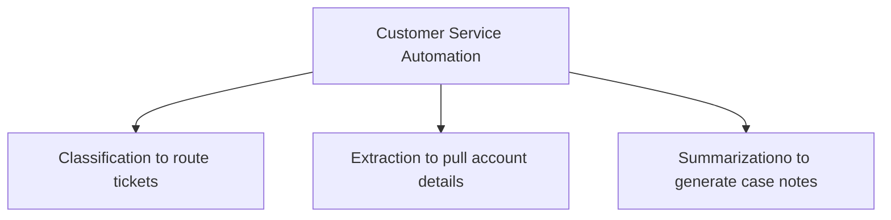

# Gen AI Solution Lifecycle: Architect's viewpoint

## Considerations of "Solutioning"

Let’s start by considering the "AI solutioning" concept which is much wider than creating specifications and agent-driven implementation within SDD.

While the process and AI architect involvement in this process share many commonalities with the traditional pre‑AI approach, it also brings new responsibilities and outcomes for architects.

```plantuml
ComponentDiagram
This diagram describes the bussiness drivers
Requirements
Architect should valdate feasiblity and provide estimates

Can do POC/PV


This will be refleced as an AISolution 
Built using AI Technology
Architect it is  in the Inception, Implementation and operations and maintenance
```

## Evaluating Case to AI Applicability

From a business perspective, and from a technical one, AI isn’t a fit for every task. A pragmatic AI architect therefore should conduct a thorough business case feasibility and technical readiness assessment, so we can avoid unnecessary risks and focus only on the opportunities that truly add value.


### Business Value

| Factor | What it measures |
|--------|-----------------|
| Task Volume & Frequency     | ROI ceiling - low volume rarely justifies AI investment |
| Task Structure | How well-defined are input, outputs and rules |
| Time Cost per Task| Time saved per instance, including cognitive overhead |
| Error Tolerance | How critical is accuracy and how much error can be tolerated |
| Task Complexity | How complex is the task and how much cognitive effort does it require |
| Context Dependency | How much tacit or undocumented knowledge is required to perform the task |

### Technical Readiness

When evaluating automation opprotunities, we should associate the business taks with hight-level technical tasks, and teh underlying task types can be relatively limited



We define **Autonomy** as the degree to which a task can be performed independently by an AI system without human intervention. Higher autonomy indicates that the AI can handle more complex and less structured tasks on its own.

* Tier 1: AI leads, human approves - AI handles the task, but human must review and approve the output.
* Tier 2: AI accelerates, human reviews - real time savings, but human still needs to review the output.
* Tier 3: AI drafts, human reworks - Starting point, expect substantial rework.
* Tier 4: Human leads or avoids - capability isn't there, or error cost is too high.

### Technical readiness

| Task Category | Autonomy Tier 1 (AI Leads) | Autonomy Tier 2 (AI Accelerates) | Autonomy Tier 3 (AI Drafts) | Autonomy Tier 4 (Human Leads) |
|---------------|-----------------------------|-------------------------------|-----------------------------|-------------------------------|
| Classification | Binary or few categories | Many categories  | Many Categories with exceptions |  -  |
| Extraction |   | X |   |   |
| Summarization |   |   | X |   |
| Translation |   |   |   | X |
| Coding |   |   |   | X |
| Document Processing |   |   |   | X |
| Research and Analysist |   |   |   | X |
| Reasoning |   |   |   | X |
| Planning and Scheduling |   |   |   | X |
| Data & Analytics |   |   |   | X |

## Timeline and activities

A GenAI solution’s lifecycle and activities can differ depending on many variables. Often, AI opportunities stall right at the business‑case stage, others die in the inception phases, and a few actually reach production before moving into maintenance.

We’re looking at this process from an architect’s lens, so the phases and activities we focus on can differ from a purely managerial perspective.

[genai_timeline-en.html](./artifacts/genai_timeline-en.html)

## Architect's Checklist

In the early stages of the GenAI solution lifecycle, an AI architect must gather all the critical inputs. By evaluating the current landscape - understanding user needs, as well as organizational and technical constraints - you’ll be able to make informed decisions. Below is a checklist designed to help architects ask the right questions and collect the essential information before kicking off a GenAI project.

[genai-check-listv04.html](./artifacts/genai-check-listv04.html)

## Why GenAI Projects Fails?

A GenAI initiative can fail by multiple reasons including when it is launched without clear, measurable business goals; when stakeholders over‑expect model “magic”; when data quality, security, and integration are ignored; and when the inherent probabilistic nature of LLMs (hallucinations, non‑determinism, black‑box behavior) is not mitigated with validation, monitoring, and human‑in‑the‑loop processes.

[genai-failures.html](./artifacts/genai-failures.html)

