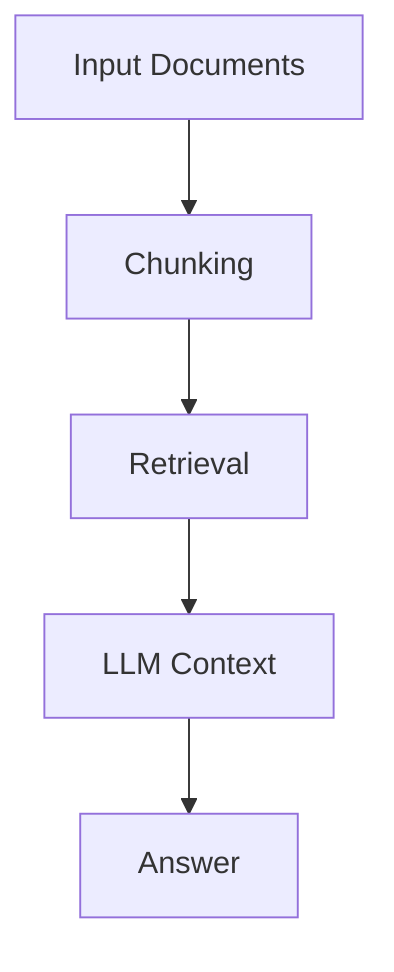
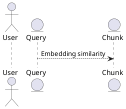
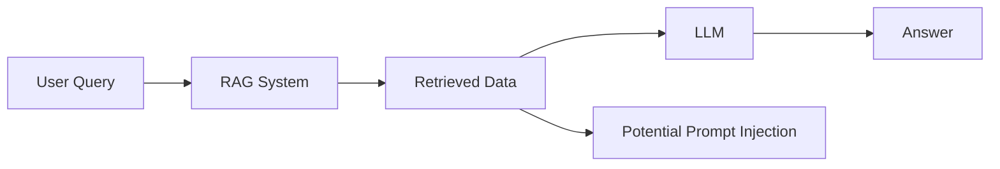

# RAG For Architects

Retrieval-Augmented Generation (RAG) lets a large language model answer questions from your documents rather than from the general knowledge it was trained on. This matters because a model's training data ages, and most organizations need answers grounded in specific, proprietary material the model has never seen.

The obvious approach — load whole documents into the model and ask away — breaks down quickly. Context windows are limited, and even large-context models often can't hold enough. When the context does get large, models tend to lose focus and miss information buried deep in the text. Big inputs are also slow and costly, make citations hard, and force the model to override its own prior knowledge — something it doesn't always do reliably.

RAG solves this by splitting documents into small pieces called chunks, retrieving only the ones relevant to a given question, and passing just those to the model. Relevance here means similar in meaning, not matching exact words: the query "How does warming affect the environment?" should surface a passage like "Rising global temperatures lead to habitat destruction and extreme weather."

Every RAG pipeline has to solve four core challenges: 
- extracting text and images from documents
- chunking them sensibly 
- retrieving the right chunks 
- and trusting the output enough to avoid hallucinations

Around these sit many practical difficulties — complex layouts and tables, embedded diagrams, specialized vocabularies, noisy queries and data, unresolved references, and chunks that depend on one another.
The sections that follow work through how to address each of these in turn.

## The Problem that RAG solves

When you ask a general-purpose LLM a question, it answers from the knowledge baked into it during training. That creates two problems for real work: the training data is frozen at some point in the past and grows stale, and the model has never seen your private, organization-specific documents. What you usually want is an answer grounded in your material, not the model's general recollection.

The intuitive fix is to paste whole documents into the model and ask away — the way you might with a chat assistant. This works for a page or two but falls apart at scale, for several reasons:

- **The context window is limited.** Every model has a maximum input size. Even models with very large windows (1–2 million tokens) often can't fit everything, and in many practical cases even that ceiling isn't enough.
- **The model loses focus.** When the input is very long, the model tends to overlook information sitting deep inside it. Tests using a well-known book — altering passages at the beginning, middle, and end, then asking about the changes — showed models answering correctly near the start but increasingly defaulting to their existing knowledge as the text grew longer. (People do something similar after a long read.)
- **Cost and latency.** Large inputs are slow and expensive on every single query.
- **Citations are hard.** Pointing back to the exact page or paragraph that produced an answer is difficult when the whole document is one undifferentiated blob.
- **Overriding the model's own knowledge is unreliable.** You can instruct the model to use only the provided text, but this works well only with small documents. With long inputs, models tend to forget the instruction; even with a short, forceful prompt, some models still answer from prior knowledge rather than the supplied facts.

## The core idea of RAG

Retrieval-Augmented Generation does exactly that. The pipeline:

1. Break the input documents into small pieces called chunks.
2. When a question arrives, retrieve only the chunks relevant to it.
3. Pass those chunks — not the whole document — to the LLM as context.
4. The model answers using that focused context.

The crucial word is relevant. Relevance here means similar in contextual meaning, not matching identical words. For example, the query "How does warming affect the environment?" should retrieve a passage like "Rising global temperatures lead to habitat destruction and extreme weather" — even though they share almost no vocabulary.

Every RAG system, no matter how it's built, has to solve four core challenges:

- **Extraction** — how do you get text (and images) out of the source documents?
- **Chunking** — how do you split a document, and what size should the pieces be?
- **Retrieval** — how do you reliably find the chunks that actually answer the question?
- **Trust** — how do you avoid hallucinations and judge whether the output can be relied on?



Beyond these four, real deployments hit a long tail of secondary difficulties worth being aware of early: complex page layouts (especially slides), tables with merged cells or footnoted legends ("all figures in millions"), diagrams and images, custom dictionaries and abbreviations, mismatched vocabulary between questions and documents, noise in the query ("Hi, quick question…"), noise in source data (HTML cruft), unresolved pronouns ("He is…"), chunks that depend on one another, and simply having too many relevant chunks to use.

> Key takeaway: RAG trades "give the model everything" for "give the model the right small thing" — and most of the engineering effort goes into making that retrieval accurate.

## Basics: Embeddings

### What "relevant" really means — embeddings

To retrieve by meaning, you can't compare text character-by-character or images pixel-by-pixel — that finds matches of form, not sense. The standard tool is the embedding: a model that converts a piece of text (or an image) into a vector of numbers. Vectors can be compared mathematically — vectors that sit close together represent texts with close meanings. That's how a query and a chunk get matched even when they share no words.



This is powerful, but it comes with caveats you must internalize, because they explain most retrieval failures:
- **Similarity is not the same as the answer.** The sentences "contract has penalty conditions" and "contract has no penalty conditions" are nearly identical in meaning-space (similarity close to 1.0) yet say opposite things. High similarity does not mean the chunk answers the question correctly.
- **Relevance is context-dependent.** "Tiger" and "cat" are similar in an animals context but not in a pets context. The embedding model's notion of similarity comes from its training data; it doesn't automatically know which context you care about.
- **Synonyms and misprints trip embeddings up.** Different embedding models disagree sharply on how similar things are, and they handle the same word's multiple meanings (e.g. "seal" the animal vs. a wax "seal" vs. a pipe "seal") inconsistently. Spelling mistakes can also degrade matching.

Because of all this, the practical rule is: don't rely on embeddings alone. Combine semantic similarity search with at least one classic keyword method like BM25. (The two produce scores on different scales, so you'll need a way to merge their results and pick the best chunks — more on that in the architecture section.)

> Key takeaway: Embeddings let you search by meaning, but they're approximate and context-bound. Treat them as one signal among several, not as ground truth.

## Basics: Types of RAG

### The different types of RAG

Not all RAG is the same. The deck draws a distinction between output patterns (what shape the answer takes) and retrieval patterns (how retrieval is wired). Any retrieval pattern can produce any output pattern — they're independent choices. The retrieval patterns are detailed in Section 3; they're previewed here so the full landscape is visible up front.

**Output patterns** — what shape is the answer?

1. **Classical text-output RAG.** Ordinary questions to documents — including questions about tables or images inside them — where the output is a text answer.
2. **RAG-based data extraction.** You have a predefined list of entities to pull out. Structured JSON output plus chain-of-thought (CoT) prompting is the recommended approach.
3. **Question to a table / tabular data.** Don't chunk tables. Use a text-to-query approach instead — generating SQL, an Elasticsearch query, or a pandas filter. Can be combined with extraction into a two-step pipeline.

**Retrieval patterns** — how is retrieval wired?

1. **Simple (in-memory) RAG.** Vectors held in memory, no database. Fine for smaller corpora (under ~1M chunks); pair similarity search with BM25.
2. **RAG with a vector database.** Indexes stored in a vector DB, with a change monitor to re-index when documents update. Needed at larger scale.
3. **RAG for entities.** Extract predefined entities into a database, then answer via text-to-query — often with a human in the loop for validation. Transparent and explainable.
4. **Request router.** Classify the incoming query and route it — to a different RAG prompt, a summary path, text-to-query, or an external tool/agent. Useful when query types vary.
5. **Graph RAG.** Adds relationships between entities so the system can answer questions a plain similarity search can't — by following relations stored separately. Used for specific relational queries.

> Key takeaway: Decide the output pattern from the business need, then choose the retrieval pattern from the data and scale. They're orthogonal — don't pick one assuming it dictates the other.

---

# RAG Pipeline

## Overview: the Shape of a RAG Pipeline

A RAG system runs in two phases, and it helps to hold the whole shape in mind before zooming into any one part.

The **indexing phase** happens once (and again whenever documents change): raw files are extracted into clean text, that text is chunked into retrievable pieces, and the chunks are indexed — embeddings plus a keyword index like BM25 — and stored. This phase is offline; you pay for it up front, not on every question.

The **answering phase** happens on every query: the user's question is pre-processed (cleaned, generalized, or expanded), the system retrieves the relevant chunks from the stored index, those chunks are assembled into a prompt, and the LLM produces the answer. Retrieval is the hinge between the two phases — it's where the indexed store gets queried — and its mechanics (in-memory vs. vector DB, routing, Graph RAG) are the subject of Section 3.

This section covers the four steps you control directly: extraction and chunking on the indexing side, query pre-processing and prompt assembly on the answering side.

```mermaid
graph LR
    Indexing in one block -- Documents -> Extract -> Chunk -> Index -> Stored Index
    Answering in another block -- User Query -> Pre-process -> Retrieve -> Assemble Prompt -> LLM Answer
    Retrieve it is connected to Stored index
```

## Extraction — Getting Clean Text Out


Before anything can be chunked or retrieved, the content has to come out of the source files — and this is harder than it looks. A few principles from the deck:

**OCR is a last resort, not a default.** OCR reads line by line, so on a multi-column page with images and tables it produces a scrambled mess. Native text extraction (especially from PDFs generated by office software) is usually enough; reach for OCR only in special cases. When you do, specialized engines like Tesseract are far stronger than asking an LLM to read the image, and OCR output can be fed to the model as an additional source rather than the only one.

**Every format has its own trap:**
- **Searchable PDF** — text isn't guaranteed to be in reading order; PDFs store blocks by coordinate, not sequence.
- **Scans** — need OCR, with recognition errors and skew.
- **HTML** — headers, footers, and menus are noise; lazy-loaded pages may need a browser automation tool to render first.
- **Word** — easy to extract, but documents have no page numbers, so you need another anchor (e.g. paragraph numbers) for citations. Convert to markdown to preserve structure.
- **PowerPoint** — complex visual layouts and embedded images.
- **Tables** — sub-totals, merged cells, and legends ("all figures in millions") can invert meaning; there's no universal extractor, only heuristics.
- **Diagrams, graphs, images, voice** — each needs special handling or a vision/multi-modal step.

**Two recurring rules:** first check whether the same data exists in a cleaner source (a database instead of a PDF table) so you can skip parsing entirely; and always verify that a parser's license permits commercial use. Docling (MIT-licensed) is a strong general-purpose option, handling PDF, DOCX, XLSX, HTML, and images with layout and table understanding.

## Chunking - Splitting Text Well

Naive splitting — cutting every N tokens — breaks meaning. A chunk boundary can land mid-sentence and strip away the word that flips the answer: "Ich liebe dich | nicht" split across chunks loses the negation entirely. Splitting cleanly by sentence is also harder than it sounds (a period inside a German date isn't a sentence end).

The better approach is to chunk by section or paragraph and carry the heading path into each chunk. Otherwise a chunk that just says "Cost is $80" is ambiguous — the model can't tell whether it's the passport fee or the visa fee.

```mermaid
TD
    A[Section 1] --> B[Paragraph 1]
    B --> C[Chunk 1 without header path]
    A --> D[Paragraph 2]
    D --> E[Chunk 2 with header path: Section 1 > Paragraph 2]
```

Naive splitting — cutting every N tokens — breaks meaning. A chunk boundary can land mid-sentence and strip away the word that flips the answer: "Ich liebe dich | nicht" split across chunks loses the negation entirely. Splitting cleanly by sentence is also harder than it sounds (a period inside a German date isn't a sentence end).

The better approach is to chunk by section or paragraph and carry the heading path into each chunk. Otherwise a chunk that just says "Cost is $80" is ambiguous — the model can't tell whether it's the passport fee or the visa fee.

```mermaid
TD
    A[Document] --> B[Root chunk]
    A --> C[Root chunk]
    B --> D[Leaf]
    C --> E[Leaf]
    B --> F[Leaf]
    C --> G[Leaf]
    B --> H[Leaf]
    C --> I[Leaf]
```

One more chunking note: when a query legitimately matches too many chunks and similarity can't separate them (a patient's age recorded at many therapy phases; near-identical clauses across legal contracts), add a classifier and store its output as chunk metadata, then filter on that before retrieval.

> Key takeaway: Chunk by structure, carry the header path, resolve references, and split search-size from answer-size. When similarity alone can't filter, lean on metadata.

## Query Pre-processing — Fixing the Question before you Search

The user's question is often a poor search key. Two techniques from the deck handle the two main failure modes.

**Step-Back** handles noise and phrasing. A real query like "Hi, my name is Pavel, can I bring my cat?" buries the actual intent under greetings and specifics. Step-Back strips the noise, optionally translates to English, and generalizes the question (e.g. "Which position did X hold from 1955–1956?" → "Which positions has X held in his career?"). The more general form retrieves more relevant material.

```mermaid
graph LR
    A[Noisy Query "Can I bring my cat?"] --> B[Step-Back (rewrite)]
    B --> C[Stay with pets? "used for search"]
```

**HyDE** (Hypothetical Document Embeddings) handles vocabulary mismatch. When the question and the documents use different language — common with legal text — you ask the LLM to draft a hypothetical answer and search with that instead of the question. The answer's vocabulary is closer to the documents'. Crucially, the hypothetical answer is used only for retrieval; it's never shown to the user.

```mermaid
graph LR
    A[Noisy Query "AI for Climate?"] --> B[HyDE (draft hypothetical answer)]
    B --> C[Hypothetical Answer "AI can help with climate issues" "used for search"]
```

> Key takeaway: Match the technique to the failure. Noisy or off-language query → Step-Back. Query and documents speak different vocabularies → HyDE.

## The RAG Prompt — Assembling the Context

Don't dump retrieved chunks into the prompt as one wall of text. Provide them as a numbered list, which lets the model reason about each chunk's relevance, score them, and produce citations:

```xml
<chunks>  <chunk id=DOC1:1> text... </chunk>
  <chunk id=DOC1:10> text... </chunk>
</chunks>
```

Use IDs like `DOC1:1` rather than bare numbers.

Required elements of a RAG prompt:
- The user's question (pre-processed if needed)
- The numbered chunk list
- A restriction: use only the provided information; do not make up an answer
- A fallback: if the answer isn't in the context, say "I have no answer"

**Optional elements** that often help: a role or context line ("You are an expert in…"), the current date, a glossary of domain terms and abbreviations, and an explicit note that the provided text is already-retrieved chunks — not full documents — so not all of them are necessarily relevant.

**Prompt caching** is a cost lever: put the static, repeated content at the top of the prompt and the dynamic content (the question) at the bottom. Caches reward a consistent prefix and a steady stream of requests; prompts unused for a while get evicted, and evictions spike during peak hours.

**A caution on hallucination-reduction prompts** (e.g. "never invent citations, label what's from memory vs. speculation, prefer accuracy over fluency, say 'I don't know'"): these are reasonable starting wording only. There's no universally "best" prompt — you have to validate candidates against your evaluation dataset, which is exactly where Section 3 picks up.

> Key takeaway: Number your chunks, always include the "only use this / else say you don't know" guardrails, order static-before-dynamic for caching, and treat every prompt as a hypothesis to be tested rather than a fixed recipe.

---

# Architectures, Quality and Deliver

## Architectures — Choosing how Retrieval is Wired

There's no one-size-fits-all RAG. The deck lays out five retrieval patterns, and the right one depends on your data, scale, and the kind of questions you need to answer — not on which is "most advanced."

Briefly, each pattern:
- **Simple** keeps vectors in memory — fine under ~1M chunks, no database needed. 
- **Vector DB** stores indexes externally and adds a change monitor to re-index when documents update. 
- **Entities** extracts predefined values into a database and answers via text-to-query, often with a human validating extractions — very transparent. 
- **Router** classifies the incoming query and dispatches it (to a different prompt, a summary path, text-to-query, or a tool/agent); beyond ~10 tools you need a tool registry. 
- **Graph** stores relationships between entities so the system can answer questions a plain similarity search can't, by following relations across multiple steps. The deck also frames these as solution tiers — Personal, Enterprise, High-quality, and Custom RAG — but the underlying retrieval choices are the five above.

> Key takeaway: Pick the simplest pattern that meets the need. Reach for a vector DB at scale, entities/text-to-query when accuracy and transparency matter, a router for mixed query types, and Graph RAG only for genuinely relational questions.

## Quality - Evaluation — proving it's good enough

You can't tune what you can't measure, and RAG quality is genuinely hard to measure. Exact-value extraction is easy to check (dates, numbers), but free-text answers have no single "correct" string — similarity isn't enough, and extra information may be right or wrong.

The deck's options: score answers with another LLM, use limited human validation, or — pragmatically — stop comparing text and compare references instead, on the assumption that "if the required chunks are in the top-2 positions with no noise, the answer will be good." Tools like RAGAS break answers into atomic claims and check each against the source.

The practical engine of evaluation is a tight loop with subject-matter experts.

```mermaid
flowchart LR
    A[RAG "Run Query"] --> B[Answer In Excel]
    B --> C[SME scoring "0 - 5"]
    C --> D[Analyze "find errors"]
    D -->|Adjust params, re-index, re-run| A
```

When you analyze failures, you're looking for why: wrong chunking, wrong similarity, hidden knowledge the SME relies on but the documents don't contain, and so on.

Across the whole test set, the goal is a dashboard with as many "green" passing cases as possible, focusing improvement effort on the "red" ones — and SMEs should keep adding the hardest cases.

Testing spans four dimensions, not just accuracy: 
- **answer quality** (right chunks found, correct answer, grounded in the documents, correct citations), 
- **security** (no unauthorized data, resistant to prompt injection and malicious documents), 
- **performance** (token limits handled, latency, indexing time, cost per answer, load), 
- **robustness** (handling noisy or misleading retrieved content). And building the Golden Dataset well means representative inputs, trusted answers, validation of small steps, and as much automation as possible.

> Key takeaway: Build a Golden Dataset with SMEs, run it repeatedly, score 0–5, and diagnose failures by cause. Where text scoring is impossible, evaluate retrieval (are the right chunks in the top-2?) instead.

## Security

Two security realities dominate RAG. The first is prompt injection: instructions and data share a single prompt, so they can't be fully separated, and text inside the retrieved data can be interpreted by the model as instructions.



The second reality follows from the first: it is not enough to write "do not show financial data" in the prompt. Role- and user-based access restrictions must be enforced by external checks on the data sources — and ideally on the response too — not by instruction alone. This matters most for public, internet-facing chatbots, where you also have to weigh DoS/DDoS exposure and runaway cost (a semantic cache helps).

> Key takeaway: Treat retrieved content as potentially adversarial, and enforce access control in code outside the prompt. Public exposure raises the stakes on injection, abuse, and cost.

## When not to use RAG — and how to deliver

A solution architect's most valuable move is sometimes to not build full RAG. For instance: an HR FAQ with a tight budget became an LLM-powered advanced search that just navigates users to the right document; a finance company's "questions about reports" became text-to-query once it turned out the data already lived in a database; a C-level "ask anything about financials, 100% accurate" request became entity extraction with human-in-the-loop, because "any question" can't be quality-guaranteed. And some cases have no viable RAG path at all — when models can't read the data (complex tables, electrical schemas, line graphs), when versioning is unresolved, or when answers depend on knowledge living only in an SME's head.

Delivery follows a staged lifecycle designed to kill risk early: collect business goals and requirements; run three PoCs (data extraction, deriving an answer + building the Golden Dataset, and integration readiness); build the MVP with scalability and UAT; then tune against real user feedback 2–3 months after go-live. Throughout, two rules recur: never promise 100% quality, and validate documents and expected queries before committing.

The final reality check is about where the effort actually goes.

A simple RAG PoC is 20–30 lines of Python with a framework like LangChain or LlamaIndex. Will the PoC work? Sure. Will it have good quality? Depends on the documents and queries. Is it production-ready? No. The PoC reaches roughly 80% of questions at 80% quality in about 20% of the time; the remaining quality — and everything around it — is the other 80% of the work.

> Key takeaway: The best RAG decision is often a cheaper alternative (advanced search, text-to-query, entity extraction). When you do build it, derisk with staged PoCs, never promise 100%, and budget for the fact that production is most of the effort.

## Additional link materials

- https://youtu.be/v3LtPuQNwh8
- https://leap.epam.com/experiment-collections/llm-introduction-for-beginners/experiments/rag_exploration
- [RAGAS example](https://docs.ragas.io/en/stable/getstarted/rag_eval/)
- [Know your RAG metrics](https://www.tweag.io/blog/2025-02-27-rag-evaluation/) 
- [Hybrid RAG](https://arxiv.org/html/2408.04948v1)
- [RAG Work Breakdown structure](https://technology.epam.com/artifacts/446)
