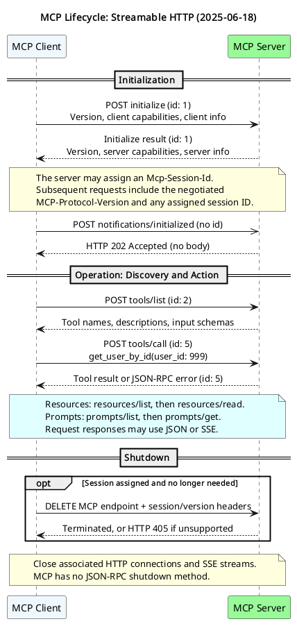
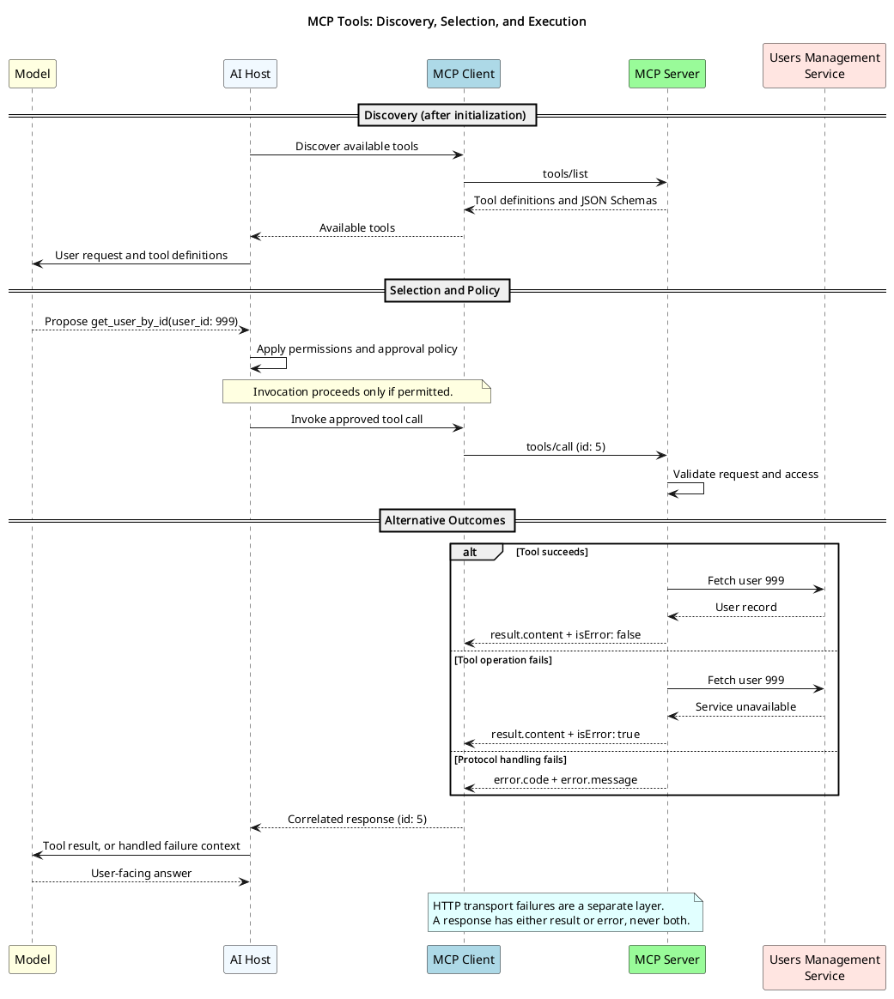

# MCP Advanced

## Introduction

The Model Context Protocol (MCP) uses [JSON-RPC 2.0](https://www.jsonrpc.org/specification)
to exchange messages between an AI application's MCP client and an MCP server.
The server exposes capabilities; the host application decides how to make them
available to the user and model.

| Area | Purpose | Example |
| --- | --- | --- |
| Base protocol | Negotiate versions and capabilities; correlate requests and responses | `initialize` |
| Tools | Expose executable operations, typically selected by the model | Look up a user by ID |
| Resources | Expose context and data, typically managed by the host application | Read a service flow diagram |
| Prompts | Expose message templates, typically selected by the user | Get a user-search prompt |
| Authorization | Control access at the transport layer | Authorize access to a protected HTTP server |

Tools, resources, and prompts are server capabilities. Authorization is a separate
concern, not a fourth discovery endpoint or a replacement for capability negotiation.
Initialization does not authenticate a user or grant access by itself.

> **Version scope:** This lesson follows the MCP **2025-06-18** specification linked
> below, not necessarily the latest revision. HTTP examples use **Streamable HTTP**,
> not the legacy HTTP+SSE transport from `2024-11-05`. The JSON-RPC bodies also apply
> to STDIO, but HTTP headers and status codes do not.

All Users Management Service names and payloads below are illustrative. A real
server's advertised capabilities and schemas are the source of truth.

## Client-Server Communication Lifecycle

There are three phases:

1. **Initialization:** Agree on a protocol version and exchange capabilities.
2. **Operation:** Discover and use the negotiated capabilities.
3. **Shutdown:** Cleanly close the underlying transport and, where supported, end the HTTP session.



Source: [diagrams/t10-mcp-lifecycle.puml](diagrams/t10-mcp-lifecycle.puml)

### JSON-RPC Message Basics

- A **request** has an `id` and `method`, plus `params` when needed.
- A **response** repeats that request's `id` and contains either `result` or `error`, never both.
- A **notification** has a `method` but no `id`; it receives no JSON-RPC response.
- Use distinct IDs for outstanding requests. The examples use sequential numeric IDs for clarity.

### HTTP Conventions

The examples assume a local server with an MCP endpoint at
`http://localhost:8005/mcp`. Substitute your server's actual endpoint.

For JSON-RPC POST requests, send:

```http
Accept: application/json, text/event-stream
Content-Type: application/json
```

After initialization, also send the negotiated version:

```http
MCP-Protocol-Version: 2025-06-18
```

If the server assigned a session ID during initialization, include that ID on all
subsequent HTTP requests:

```http
Mcp-Session-Id: example-session-id
```

**Session IDs are optional.** A server may operate without them; in that case, omit
the session header. A session ID is not an authorization credential.

For a JSON-RPC request, the server may return a single JSON response or an SSE
stream containing the response. Examples below show the JSON bodies without SSE
framing. A client must support both response forms.

## Initialization

Initialization is a three-step handshake: request, response, then notification.
Do not begin normal capability operations until the handshake is complete.

### Step 1: Initialize Request

The client sends a version it supports, its capabilities, and its implementation
identity. An empty capabilities object means the client advertises no optional
client capabilities, such as sampling or filesystem roots.

```bash
curl --include --no-buffer 'http://localhost:8005/mcp' \
  --header 'Accept: application/json, text/event-stream' \
  --header 'Content-Type: application/json' \
  --data '{
    "jsonrpc": "2.0",
    "id": 1,
    "method": "initialize",
    "params": {
      "protocolVersion": "2025-06-18",
      "capabilities": {},
      "clientInfo": {
        "name": "course-mcp-client",
        "version": "1.0.0"
      }
    }
  }'
```

### Step 2: Initialize Response

An example response body:

```json
{
  "jsonrpc": "2.0",
  "id": 1,
  "result": {
    "protocolVersion": "2025-06-18",
    "capabilities": {
      "tools": { "listChanged": true },
      "resources": {},
      "prompts": {}
    },
    "serverInfo": {
      "name": "custom-ums-mcp-server",
      "version": "1.0.0"
    }
  }
}
```

If the server supports the requested version, it must return that same version.
Otherwise, it returns another version it supports. If the client cannot support
the returned version, it should disconnect rather than continue incompatibly.

Capability objects advertise supported features:

- `tools.listChanged: true` means the server supports tool-list change notifications.
- `resources: {}` and `prompts: {}` advertise basic support without optional features.
- Unsupported capabilities are omitted, not represented by `null`.

A stateful HTTP server may also return the following **HTTP response header**,
which is not part of the JSON body:

```http
Mcp-Session-Id: example-session-id
```

### Step 3: Initialized Notification

The client acknowledges readiness with `notifications/initialized`. This example
assumes the server returned the session ID above; replace it with the actual value
or omit that header if no session ID was issued.

```bash
curl --include 'http://localhost:8005/mcp' \
  --header 'Accept: application/json, text/event-stream' \
  --header 'Content-Type: application/json' \
  --header 'MCP-Protocol-Version: 2025-06-18' \
  --header 'Mcp-Session-Id: example-session-id' \
  --data '{
    "jsonrpc": "2.0",
    "method": "notifications/initialized"
  }'
```

An accepted notification receives **HTTP 202 Accepted with no body**. That is a
transport acknowledgment, not a JSON-RPC result. Over STDIO, there is no HTTP 202
and no response to the notification.

## Operation

For this lesson, normal operations are grouped into **discovery** and **action**.
Only use capabilities advertised during initialization.



Source: [diagrams/t10-mcp-tool-call.puml](diagrams/t10-mcp-tool-call.puml)

### Discovery

Discovery returns metadata, not execution results or resource contents.

| Capability | Discovery method | Action method | Action identifier |
| --- | --- | --- | --- |
| Tools | `tools/list` | `tools/call` | Tool `name` and `arguments` |
| Resources | `resources/list` | `resources/read` | Resource `uri` |
| Prompts | `prompts/list` | `prompts/get` | Prompt `name` and optional `arguments` |

For all JSON-RPC request bodies below, POST to the same MCP endpoint using the
HTTP conventions above. STDIO clients send the same bodies as newline-delimited
JSON messages, without HTTP headers.

#### List Tools

Request:

```json
{
  "jsonrpc": "2.0",
  "id": 2,
  "method": "tools/list"
}
```

Response:

```json
{
  "jsonrpc": "2.0",
  "id": 2,
  "result": {
    "tools": [
      {
        "name": "get_user_by_id",
        "description": "Provides user information by user ID.",
        "inputSchema": {
          "type": "object",
          "properties": {
            "user_id": {
              "type": "integer",
              "description": "User ID"
            }
          },
          "required": ["user_id"]
        }
      }
    ]
  }
}
```

The host can expose this description and JSON Schema to the model so it can
propose a valid tool call. Listing a tool does not execute it.

#### List Resources

Request:

```json
{
  "jsonrpc": "2.0",
  "id": 3,
  "method": "resources/list"
}
```

Response:

```json
{
  "jsonrpc": "2.0",
  "id": 3,
  "result": {
    "resources": [
      {
        "name": "get_flow_diagram",
        "uri": "users-management://flow-diagram",
        "description": "Users Management Service flow diagram.",
        "mimeType": "image/png"
      }
    ]
  }
}
```

#### List Prompts

Request:

```json
{
  "jsonrpc": "2.0",
  "id": 4,
  "method": "prompts/list"
}
```

Response:

```json
{
  "jsonrpc": "2.0",
  "id": 4,
  "result": {
    "prompts": [
      {
        "name": "user_search_assistant_prompt",
        "description": "Helps users formulate effective search queries.",
        "arguments": []
      },
      {
        "name": "user_profile_creation_prompt",
        "description": "Guides creation of realistic user profiles.",
        "arguments": []
      }
    ]
  }
}
```

All three list methods support pagination. If a response includes `nextCursor`,
repeat that method with `params: {"cursor": "<returned-cursor>"}` and a new request
ID until no `nextCursor` remains.

If the server advertises `tools.listChanged`, it can send this notification when
its tool catalog changes. The client should then refresh with `tools/list`:

```json
{
  "jsonrpc": "2.0",
  "method": "notifications/tools/list_changed"
}
```

Resources and prompts have corresponding list-change notifications when their
own `listChanged` feature is advertised. Listing support alone does not imply
notification support.

### Action: Call a Tool

The model proposes a tool name and arguments. The host applies its permissions
and approval policy, then directs its MCP client to send the request. The server
validates inputs and permissions, calls the underlying service, and returns a
result. The host can then pass that result to the model for its final answer.

Request:

```json
{
  "jsonrpc": "2.0",
  "id": 5,
  "method": "tools/call",
  "params": {
    "name": "get_user_by_id",
    "arguments": { "user_id": 999 }
  }
}
```

The following are **alternative responses to the same request**, not three
messages sent in sequence.

#### Success Response

```json
{
  "jsonrpc": "2.0",
  "id": 5,
  "result": {
    "content": [
      {
        "type": "text",
        "text": "{\"id\":999,\"name\":\"Alex Example\",\"email\":\"alex@example.com\"}"
      }
    ],
    "isError": false
  }
}
```

Here, `content` contains a text block whose text happens to be serialized JSON.
Tools may also return other content types or a `structuredContent` object.
`isError` is optional; when omitted, it is assumed to be `false`.

#### Tool Execution Error

The request reaches the tool, but its underlying operation fails:

```json
{
  "jsonrpc": "2.0",
  "id": 5,
  "result": {
    "content": [
      {
        "type": "text",
        "text": "Unable to retrieve user 999: Users Management Service is unavailable."
      }
    ],
    "isError": true
  }
}
```

This is still a JSON-RPC `result`. The failure is reported inside the tool result
so the model can understand it and respond appropriately.

#### JSON-RPC Error

The server cannot process the request correctly at the protocol layer:

```json
{
  "jsonrpc": "2.0",
  "id": 5,
  "error": {
    "code": -32603,
    "message": "Internal error"
  }
}
```

For other requests, common codes include `-32601` for an unknown JSON-RPC method
and `-32602` for invalid parameters, such as an unknown tool name. An unknown
**tool name** is not the same as an unknown **method**: `tools/call` can be a valid
method even when the requested tool does not exist.

| Outcome | Response shape | Meaning |
| --- | --- | --- |
| Success | `result.content`, with `isError: false` or omitted | Tool completed successfully |
| Tool execution error | `result.content`, with `isError: true` | Tool ran but its operation failed |
| JSON-RPC error | Top-level `error.code` and `error.message` | Request could not be processed correctly |

**HTTP errors are a separate layer.** For example, a missing session ID on a
server that requires one should cause HTTP 400; an expired session causes HTTP
404. These are not tool results. The HTTP error body may also contain a JSON-RPC
error, but clients must inspect the HTTP status as well. After a session-related
404, the client must initialize a new session without the old session header.

### Action: Read a Resource

Use the discovered URI, not a tool name:

```json
{
  "jsonrpc": "2.0",
  "id": 6,
  "method": "resources/read",
  "params": { "uri": "users-management://flow-diagram" }
}
```

An image resource returns base64-encoded binary data in `blob`. This complete,
small PNG is an encoding example, not the actual service diagram:

```json
{
  "jsonrpc": "2.0",
  "id": 6,
  "result": {
    "contents": [
      {
        "uri": "users-management://flow-diagram",
        "mimeType": "image/png",
        "blob": "iVBORw0KGgoAAAANSUhEUgAAAAEAAAABCAYAAAAfFcSJAAAADUlEQVR4nGNgYGBgAAAABQABpfZFQAAAAABJRU5ErkJggg=="
      }
    ]
  }
}
```

Text resources use `text` instead of `blob`. Resource reads return `contents`
(plural), unlike a tool result's `content` array.

### Action: Get a Prompt

```json
{
  "jsonrpc": "2.0",
  "id": 7,
  "method": "prompts/get",
  "params": { "name": "user_search_assistant_prompt" }
}
```

Response:

```json
{
  "jsonrpc": "2.0",
  "id": 7,
  "result": {
    "description": "User search guidance",
    "messages": [
      {
        "role": "user",
        "content": {
          "type": "text",
          "text": "Help me find a user. Ask for the search criteria, use the available user-search tools, and summarize only returned records."
        }
      }
    ]
  }
}
```

Getting a prompt retrieves messages; it does not call an LLM or execute a tool.
The host chooses how to incorporate those messages into the conversation.

## Shutdown

MCP defines no JSON-RPC `shutdown` method. Cleanup depends on the transport.

| Transport | Graceful cleanup |
| --- | --- |
| STDIO | Close the server subprocess's input stream and wait for it to exit. If it does not exit within a reasonable time, send `SIGTERM`, then `SIGKILL` if necessary. |
| Streamable HTTP | Close associated HTTP connections or SSE streams. If a session ID was issued and the session is no longer needed, the client should also send HTTP `DELETE` to the MCP endpoint. |

Example explicit HTTP session termination:

```bash
curl --include --request DELETE 'http://localhost:8005/mcp' \
  --header 'MCP-Protocol-Version: 2025-06-18' \
  --header 'Mcp-Session-Id: example-session-id'
```

A server may return **405 Method Not Allowed** if it does not support
client-initiated session termination. Closing an HTTP connection alone does not
necessarily delete a stateful session or cancel an in-progress request.

## Summary

- **Initialize:** Agree on a version, exchange capabilities, and send the initialized notification.
- **Discover:** List tools, resources, or prompts to learn what the server offers.
- **Act:** Call a tool, read a resource, or retrieve a prompt using its advertised identifier.
- **Handle results:** Distinguish tool execution failures, JSON-RPC errors, and HTTP transport errors.
- **Shut down:** Release transport resources and explicitly terminate HTTP sessions where supported.

## References

- [MCP lifecycle (2025-06-18)](https://modelcontextprotocol.io/specification/2025-06-18/basic/lifecycle)
- [MCP transports and session management (2025-06-18)](https://modelcontextprotocol.io/specification/2025-06-18/basic/transports)
- [MCP tools (2025-06-18)](https://modelcontextprotocol.io/specification/2025-06-18/server/tools)
- [MCP resources (2025-06-18)](https://modelcontextprotocol.io/specification/2025-06-18/server/resources)
- [MCP prompts (2025-06-18)](https://modelcontextprotocol.io/specification/2025-06-18/server/prompts)

