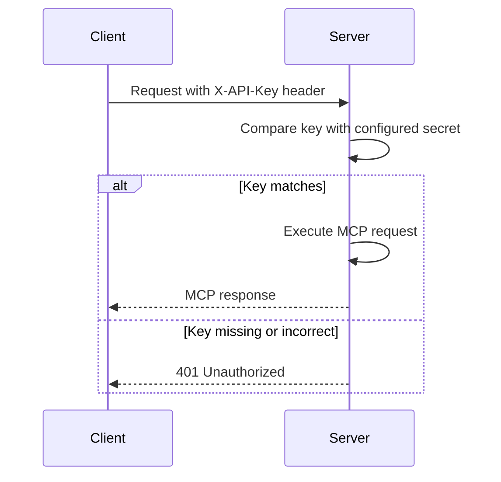
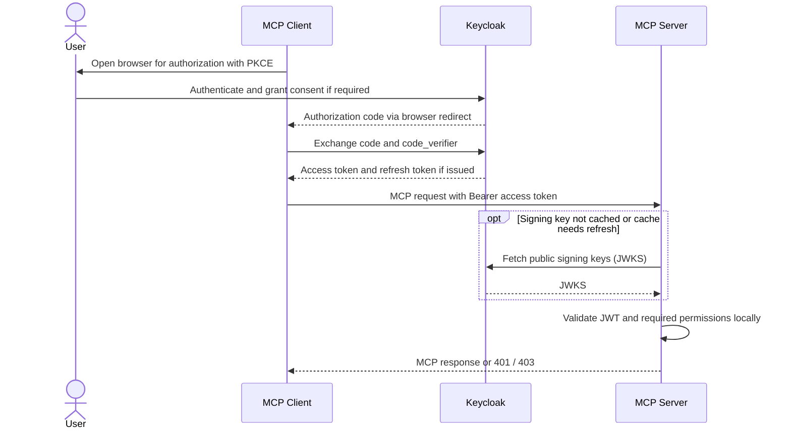
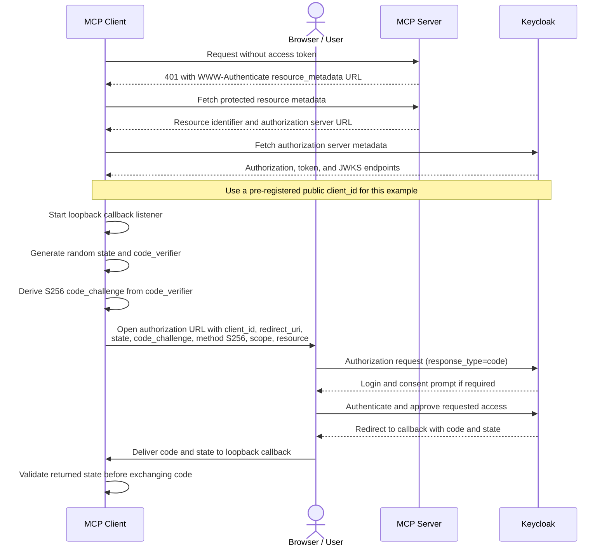
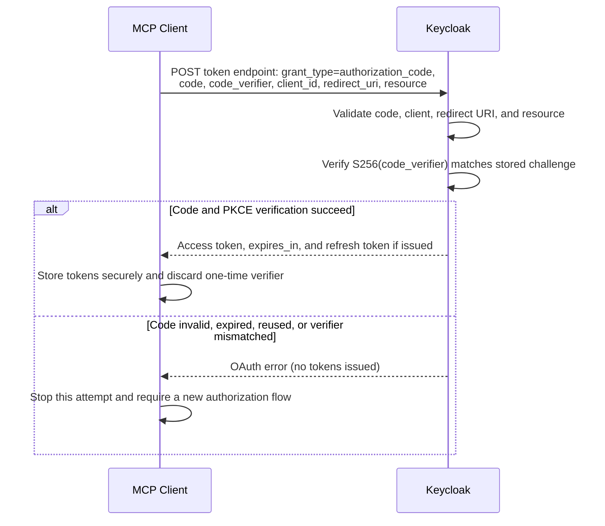
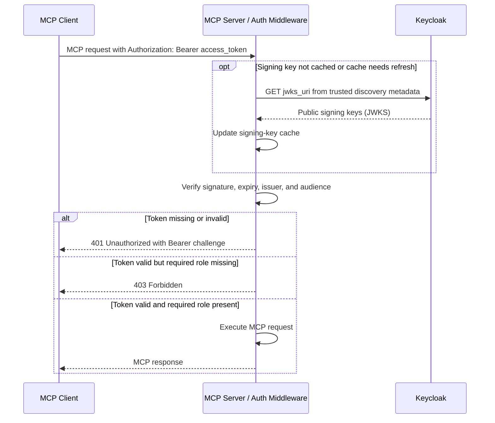
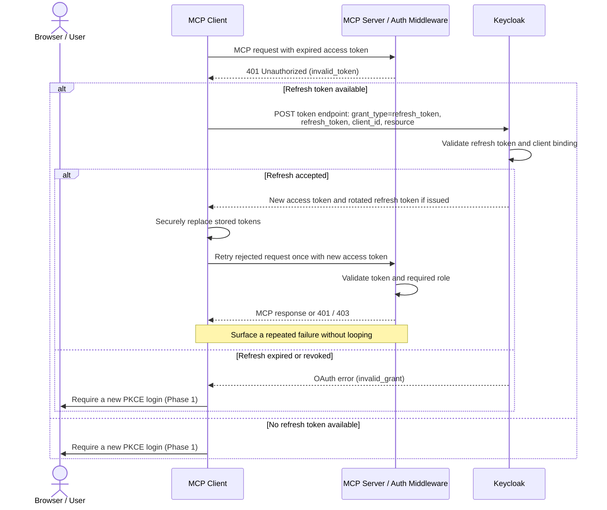

# MCP Auth

## Introduction

> MCP servers expose powerful capabilities, such as external API calls, database queries, file operations. Without authentication, anyone who can reach the server's HTTP endpoint can invoke these tools freely.

Previously, the Users Management MCP service used STDIO transport, running the server and client on the same machine as subprocesses, with the OS serving as the security boundary. Since there was no network exposure, no credentials were required.

We also added Streamable HTTP transport without authentication to access the service. This approach is fine for a pet project but unacceptable for production, where securing those endpoints is essential.

> **Important**: Authentication only applies to Streamable HTTP. STDIO transport has no network surface, it requires no credentials and no auth setup at all.

> **Note on terminology**: The official MCP authorization specification is built on OAuth 2.1 and a set of supporting RFCs. Authorization itself is OPTIONAL for MCP implementations; when an HTTP-based transport does support it, the implementation SHOULD conform to the spec. API key authentication is a pragmatic, non-standard alternative that is not part of the MCP specification.

What authentication gives you:

| Benefit | Description |
| - | - |
| Access control | Only authorized callers can invoke your MCP tools. Every unauthenticated request is rejected at the HTTP layer before any business logic runs. |
| Identity | With OAuth, the token carries the user's identity, so you know not just that someone called, but who called. Enables audit logs and user-specific behaviour. |
| Fine-grained permissions | OAuth roles and scopes allow different callers to have different capabilities, like admin vs read-only, user A vs user B. |
| Token lifecycle | OAuth tokens expire automatically. A compromised token becomes useless after a short TTL, unlike a static API key, which is valid forever until manually rotated. |

Two approaches covered in this module:

| Property | API Key | OAuth 2.0 + PKCE |
| - | - | - |
| Complexity | Low | Medium – High |
| User identity in token | ❌ No | ✅ Yes |
| Role-based permissions | ❌ No | ✅ Yes |
| Token expiry | ❌ Never | ✅ Yes + auto refresh |
| External auth server needed | ❌ No | ✅ Yes |
| Official MCP spec | ⚠️ Unofficial | ✅ Official |
| Best for | Internal tools, dev, prototypes | Production, multi-user, public-facing |

## API Key Authentication

> API key auth is the simplest possible protection for an MCP server. A shared secret is agreed between the server operator and the client. The client sends it as a custom HTTP header (`X-API-Key`) on every request. The server checks it before allowing access.

> ⚠️ Not in the MCP specification. API key auth is not defined by the official MCP protocol. It is a custom, pragmatic layer implemented at the HTTP middleware level, completely transparent to the MCP protocol itself. For HTTP authorization, the MCP specification describes an OAuth 2.1-based framework; authorization itself is optional.

Official references:

- [MCP Authorization Specification](https://modelcontextprotocol.io/specification/draft/basic/authorization) -- Official
- [RFC 6750 (OAuth 2.0 Bearer Token Usage)](https://datatracker.ietf.org/doc/html/rfc6750) -- RFC

### How it works

The entire mechanism fits into a single mental model: a shared secret compared on every request. The server and client must agree on the same key value, typically loaded from an environment variable or propagated by the user connecting to the MCP server.

### Server Side

The server's job is to intercept every incoming HTTP request before it reaches the MCP tools and validate the key. This is done using HTTP middleware, which is a layer that runs on every request, independent of your tool implementations. The middleware reads the `X-API-Key` header, compares it to the configured secret, and either 200 passes the request through or returns a 401 response immediately.

**Key points:**

* Auth logic lives in a single middleware class, completely separate from your MCP tool definitions
* Adding auth doesn't touch a single tool
* The check is a simple string comparison in memory, no network calls, negligible performance impact
* The key is loaded from an environment variable or propagated by the user to your application in a request

### Client Side

The client's only responsibility is to include the API key header on every HTTP request it sends to the MCP server. This is done by configuring the underlying HTTP client with a pre-set header, so it is automatically attached to every request without any per-call logic.

The MCP client constructs an HTTP client instance with the header pre-configured, then passes this HTTP client to the MCP transport layer. From that point on, all MCP protocol messages (tool calls, resource fetches, etc.) automatically carry the API key.

> The key should never appear in source code. Load it from an environment variable on the client side using the same variable name as the server. This ensures the secret is managed outside the codebase and can be rotated without a code change.

### Pros & Cons

| ✅ Pros | ❌ Cons |
| --- | --- |
| Trivial to implement, one middleware class, no dependencies | No user identity, you know a client called, not who |
| No external services needed, works completely offline | Keys usually never expire; a leaked key is valid until manually rotated |
| Zero latency overhead, in-memory string comparison only | No granular permissions, all-or-nothing access for every caller |
| Easy to debug, check one header in server logs | Key rotation is a manual operational burden at scale |
| Great for controlled, internal service-to-service calls | Not compliant with the official MCP authorization specification |
| Perfect for learning and early prototyping | Sharing secrets across environments carries inherent security risk |

### When to use

✅ Use API Key when:
* You control both client and server
* Local development or prototype environment
* Server is not publicly accessible
* Service-to-service with no human users
* You need something working in minutes

❌ Avoid when:
* Server is publicly exposed on the internet
* Different users need different access levels
* You need audit trails per user identity
* Compliance mandates proper OAuth / OIDC
* Building a product for external customers

## OAuth 2.0 + PKCE Authentication

The MCP specification defines an OAuth 2.1-based authorization framework for HTTP-based MCP servers, with PKCE protecting the authorization code flow. Rather than a shared secret, the client obtains a short-lived access token from a dedicated Authorization Server (Keycloak in our case) and presents it to the MCP server on every request.

The MCP server never issues tokens. It only validates them. This separation of concerns, like token issuance vs. token validation, is a core principle of the MCP authorization specification.

### Official References

* [MCP Authorization Specification](https://modelcontextprotocol.io/specification/2025-06-18/basic/authorization)
* [OAuth 2.1 - IETF Draft](https://datatracker.ietf.org/doc/html/draft-ietf-oauth-v2-1)
* [RFC 7636 - PKCE](https://datatracker.ietf.org/doc/html/rfc7636)
* [RFC 8414 - Authorization Server Metadata](https://datatracker.ietf.org/doc/html/rfc8414)
* [RFC 9728 - Protected Resource Metadata](https://datatracker.ietf.org/doc/html/rfc9728)

### Key Concepts

| Concept | Description |
| --- | --- |
| Authorization Server | The service that authenticates users and issues access tokens. In our task this is Keycloak. The MCP server trusts whatever Keycloak vouches for. |
| Resource Server | The MCP server's role in OAuth. It holds the protected resources (tools). It validates tokens but never issues them. |
| Access Token (JWT) | A short-lived, cryptographically signed token issued by the Authorization Server. Contains the user's identity, roles, expiry time, and issuer. The MCP server validates the signature without calling Keycloak. |
| Refresh Token | A longer-lived token used to obtain a new access token when the current one expires without making the user log in again. |
| PKCE | A security extension that protects the authorization code from interception. The client generates a secret pair locally. Even if the auth code is stolen mid-redirect, it is useless without the original secret. |
| JWKS | Authorization Server's public signing keys, published at a URL advertised in discovery metadata. The MCP server caches them to verify JWT signatures locally and refreshes the cache as needed for key rotation. |
| Realm Roles | Authorization Server groups users into roles (e.g. mcp-tools-access). The JWT contains these roles. The MCP server checks for the required role, and a valid token without the right role gets a 403. |
| Discovery Endpoint | A well-known URL on the Authorization Server that describes all its endpoints. Clients use this to find the token URL, auth URL, and JWKS URL, so nothing is hardcoded. |

> Why PKCE instead of a client secret?
> CLI tools and agent applications are public clients, they run on user machines where secrets cannot be safely stored. PKCE replaces the need for a client secret by using a one-time cryptographic challenge generated fresh for each login. Even if an attacker intercepts the authorization code during the browser redirect, they cannot exchange it without the original `code_verifier` that exists only in the client's memory.

### Server Side

The MCP server's auth responsibility is token validation only. It must answer two questions on every request:

1. Is this token valid? Verify the JWT signature using Authorization Server's public keys (JWKS). Check that the token hasn't expired, was issued by the expected issuer, and has this MCP server as its intended audience. Validation is local when the required signing key is cached.
2. Does this user have permission? Read the realm_access.roles claim from the JWT. If the required role is present → allow. If not → 403 Forbidden.

The public keys (JWKS) are fetched and cached in memory. Refresh the cache according to the verifier's cache policy and when an unfamiliar signing key appears, so Keycloak key rotation does not require a server restart. Normal JWT validation uses cached keys, without a Keycloak call per request.

> 401 vs 403 — the distinction matters:
> 
> * 401 Unauthorized → "I don't recognize you. Provide a valid token." The client should attempt to get a new token.
> * 403 Forbidden → "I know who you are, but you don't have permission." Getting a new token won't help, the user simply lacks the required role.
> 
> The MCP specification requires this distinction.

### Client Side

The client must complete the full PKCE authorization flow before it can connect to the MCP server. Once it has an access token, it behaves similarly to the API key setup, so the token is attached as a header (Authorization: Bearer <token>) on every request.
The client also handles token refresh: when an access token expires, the client uses its refresh token, if issued, to obtain a new access token from Authorization Server, then retries the rejected request once. If refresh is unavailable or rejected, the client must ask the user to log in again. A `403` is a permission failure, not a reason to refresh.

**Key responsibilities:**
* Open the browser to Keycloak's login page (once, on startup)
* Start a local callback server to receive the auth code after login
* Generate the PKCE `code_verifier` / `code_challenge` pair locally
* Exchange the auth code + `code_verifier` for tokens
* Attach `Authorization: Bearer <token>` on every MCP request
* On an expired-token `401`: refresh if possible and retry once; otherwise require login

### Complete Request Flow

The full OAuth + PKCE flow spans four parties and four phases.

Phase 1 — PKCE Setup & Authorization Request

Phase 2 — Token Exchange

Phase 3 — Authenticated MCP Tool Calls

Phase 4 — Token Refresh (when access token expires)

### Pros and Cons

| ✅ Pros | ❌ Cons |
| --- | --- |
| User identity in every token, full audit trail per individual | Significantly more complex than API key auth |
| Tokens expire automatically, and compromised credentials self-invalidate | Requires a running Authorization Server (Keycloak, Auth0, etc.) |
| Role-based access control differentiates users by permission level | Browser-based login is awkward for fully automated, headless agents |
| Compliant with the official MCP specification | Token refresh logic must be handled on the client side |
| Works with any OAuth 2.0 provider: Keycloak, Auth0, Azure AD, Google | JWKS fetch creates a startup dependency on Keycloak being available |
| Industry standard (familiar to security teams and auditors) | More moving parts — more to configure and debug |
| Centralized user management | |

### When to use:

✅ Use OAuth when:
* MCP server is publicly accessible on the internet
* Different users need different permission levels
* You need per-user audit trails
* Compliance (SOC 2, GDPR, etc.) is required
* Building a multi-tenant product for external users
* Long-term production system

❌ Avoid when:
* Quick local prototype or personal dev tool
* Still learning MCP fundamentals
* Keycloak overhead is not justified for the use case
* Fully headless service-to-service with no human users

## Summary

Full comparison:
| Criterion | API Key | OAuth 2.0 + PKCE |
| --- | --- | --- |
| Transport mechanism | X-API-Key header | Authorization: Bearer <JWT> |
| Validated by | String comparison in middleware | JWT signature + roles check in middleware |
| External auth server | ❌ Not required | ✅ Required (Keycloak) |
| User identity | ❌ No | ✅ Yes — in JWT claims |
| Permission levels | ❌ All-or-nothing | ✅ Role-based (mcp-tools-access) |
| MCP spec compliance | ⚠️ Custom / unofficial | ✅ Official spec |
