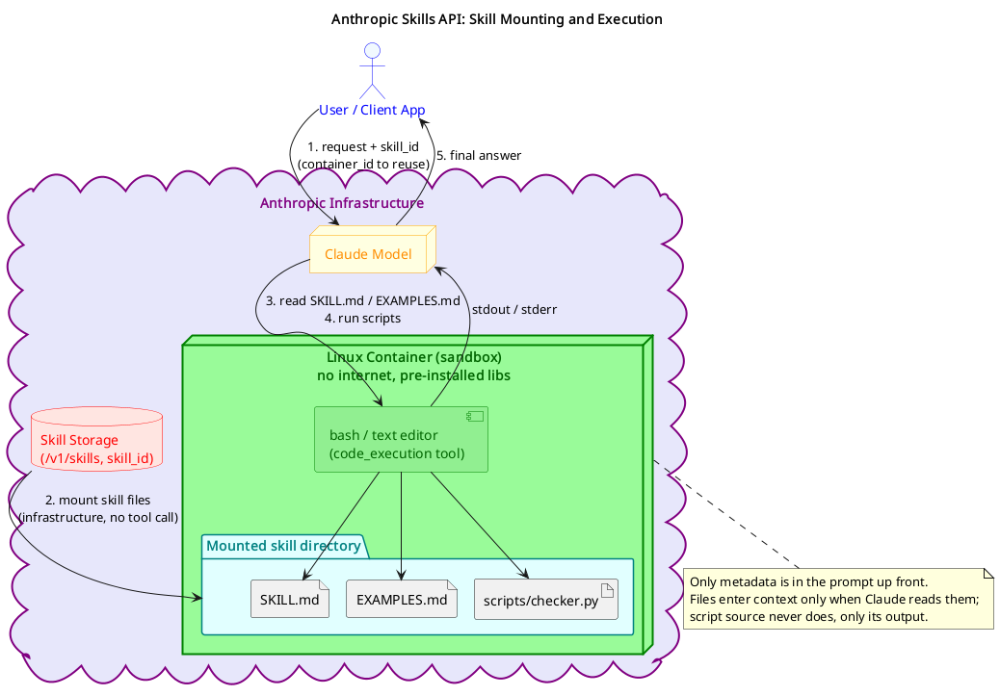
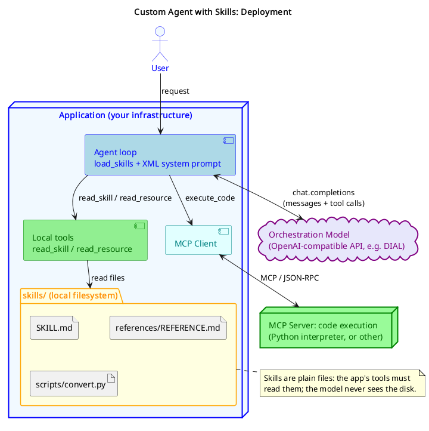
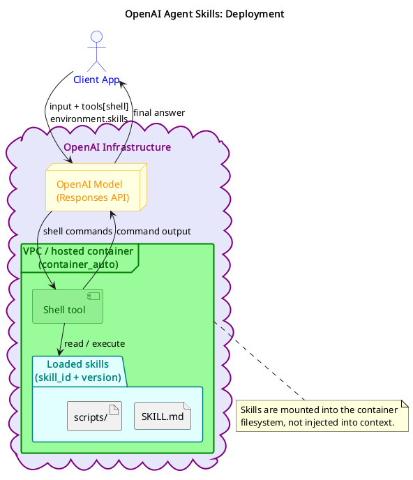
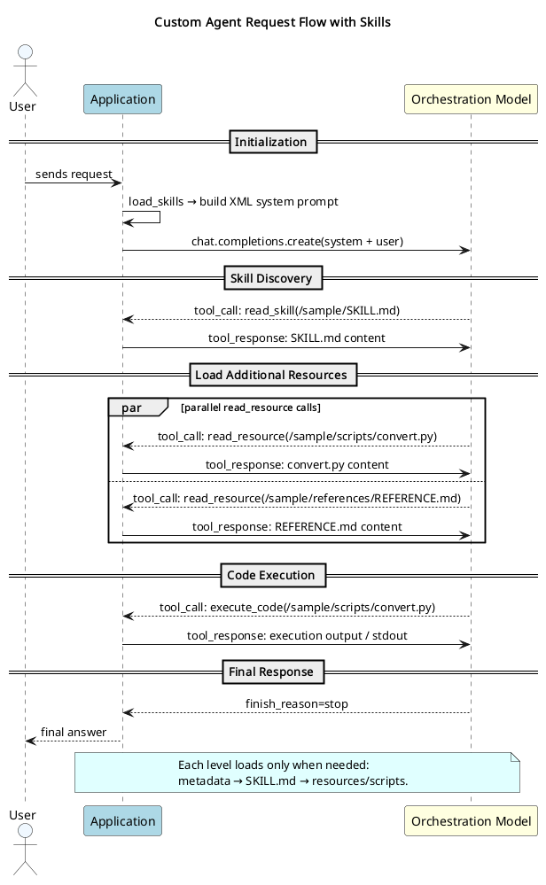

# Agent Skills

## What are Agent Skills

A skill is a self-contained, reusable capability you give to an AI agent, and is packaged as a folder of files rather than hardcoded into your application.

Think of it like an onboarding guide for a new employee. Instead of re-explaining the company process to every new hire from scratch, you write it once, hand them the folder, and they figure it out.

```text
style-guide/
├── SKILL.md        ← instructions (what to do, when to do it)
├── EXAMPLES.md     ← reference examples
└── scripts/
    └── checker.py  ← executable tool the agent can run
```

The agent reads this folder when it's relevant, follows the instructions, and uses the scripts as needed — without you ever pasting context into the conversation.

### The Problem They Solve

Every new conversation with an LLM is a blank slate. If your team has a company writing style, a specific DB schema, or a multi-step support workflow, you'd have to paste all of that context every single time. This is expensive (repeated tokens), slow (long system prompts hurt latency), and error-prone (copy-paste inconsistencies).

Skills solve this with progressive disclosure, where only the relevant knowledge is loaded at the right moment:

> ① Startup:   Only skill names + descriptions loaded      (~100 tokens per skill)
> ② Triggered: Full SKILL.md loaded when relevant         (~2-5K tokens)
> ③ On demand: Scripts/references loaded if needed     (zero tokens if unused)

You can have 20 skills installed and only pay for the one that's actually used.


✅ Best Practices

1. Be concise

  The context window is shared between the system prompt, conversation history, other skills' metadata, and the actual request. Every token in SKILL.md competes with all of that once the skill is triggered.

  Only add context the model doesn't already have. Before writing anything, ask:
  * Does the model really need this explanation?
  * Can I assume it already knows this?
  * Does this sentence justify its token cost?

  Keep SKILL.md body under 500 lines. Move detailed reference material to separate files and link to them.

2. Set the right level of freedom
  Match specificity to how fragile and variable the task is.
  High freedom: plain text instructions when multiple approaches are valid and context should guide the decision (e.g. code review, writing tasks)
  Medium freedom: pseudocode or parameterised templates when a preferred pattern exists but variation is acceptable (e.g. report generation)
  Low freedom: exact commands or scripts with no parameters when the operation is fragile, order-sensitive, or must be consistent (e.g. database migrations, XML pipelines)

3. Naming
  * Use lowercase letters, numbers, and hyphens only (max 64 characters). The name must match the folder name exactly.
  * Prefer gerund form, it clearly describes what the skill does: processing-pdfs, analyzing-spreadsheets, managing-databases
  * Avoid vague names: helper, utils, tools, data, files.
4. Write effective descriptions
  * The description is the routing signal, it is the only thing the model reads when deciding whether to trigger the skill at all.
  * Write in third person (it gets injected into the system prompt)
  * Describe what it does AND when to use it
  * Include specific keywords that match likely user requests
  * Max 1024 characters

> 👍 Good:
> description: Extracts text and tables from PDF files, fills forms, merges documents.
> Use when working with PDF files or when the user mentions PDFs, forms, or document extraction.

>👎 Bad:
> description: Helps with documents

5. Structure for progressive disclosure
Keep SKILL.md as a high-level guide that points to deeper files as needed, like a table of contents in an onboarding manual.

  ```text
  my-skill/
  ├── SKILL.md          ← overview + links to other files (loaded on trigger)
  ├── EXAMPLES.md       ← usage examples (loaded on demand)
  ├── REFERENCE.md      ← detailed reference (loaded on demand)
  └── scripts/
      └── process.py    ← executed; source code never enters context
  ```

  Keep all linked files one level deep from SKILL.md. If Claude encounters nested references (SKILL.md → advanced.md → details.md), it may only partially read the chain.
  For reference files longer than ~100 lines, add a table of contents at the top so Claude can understand the full scope even when previewing partially.
6. Use workflows and feedback loops
For multi-step tasks, provide a numbered workflow with a copy-paste checklist. This prevents the model from skipping critical stages.
  Build in validation loops: run → validate → fix → repeat. After every consequential operation, run a validator and only proceed when it passes. Make error messages specific: "Field 'date' not found. Available: customer_name, total" lets the model self-correct without another round-trip.
7. Content guidelines
  Avoid time-sensitive information. Don't write "Before August 2025, use the old API" because this becomes wrong silently. Use an ## Old patterns section for deprecated content and keep the main instructions perpetually current.
  Use consistent terminology. Pick one term and stick to it:
  Not "endpoint / URL / route / path" → always "endpoint"
  Not "field / box / element / control" → always "field"

8. Scripts and executable code
Scripts are more reliable than code generated on the fly, and their source never enters the context window, only stdout/stderr does. This makes them far more token-efficient than asking the model to write equivalent code each time.
  Make intent explicit in instructions:
  "Run analyze_form.py to extract fields" → execute it
  "See analyze_form.py for the extraction algorithm" → read it as reference

Scripts must handle their own errors. A raw traceback forces the model to improvise, but explicit error messages with clear recovery paths are much more reliable.

**Package dependencies:** the API container has no network access and no runtime installation, and only pre-installed packages are available. List required packages in SKILL.md and verify they exist before using them.

### Anti-patterns to avoid

* **Windows-style paths:** always use forward slashes (scripts/run.py, not scripts\run.py)
* **Too many options:** pick a default and mention alternatives only as an explicit escape hatch
* **Nested references:** keep all linked files one level deep from SKILL.md
* **Assuming packages are installed:** always declare dependencies explicitly
* **Vague descriptions:** if the description doesn't say when to use the skill, it won't trigger reliably

## Anthropic Skills API

> Official docs: [Anthropic Skills API](https://platform.claude.com/docs/en/agents-and-tools/agent-skills/overview)

Anthropic's Skills API (currently in beta) provides two categories of skills.

### Pre--built Skills

Anthropic ships four first-party skills you can reference by ID, no upload needed:

| Skill ID | What It Does |
|---------|-------------|
| pptx | Creates and edits PowerPoint presentations |
| xlsx | Creates spreadsheets, analyses data |
| docx | Creates and edits Word documents |
| pdf | Generates formatted PDF documents |

### Custom Skills

You upload your own skill directory (or ZIP) via the /v1/skills endpoint. Once uploaded, it is stored persistently in Anthropic's infrastructure and gets a skill_id you reference in future requests.

Upload:

```bash
curl -X POST https://api.anthropic.com/v1/skills \
  -H "x-api-key: $ANTHROPIC_API_KEY" \
  -H "anthropic-beta: skills-2025-10-02" \
  -H "anthropic-version: 2023-06-01" \
  -F "files[]=@./style-guide/SKILL.md;filename=style-guide/SKILL.md" \
  -F "files[]=@./style-guide/EXAMPLES.md;filename=style-guide/EXAMPLES.md"
```

Use in a request:

```json
{
  "model": "claude-sonnet-4-6",
  "tools": [
    { "type": "code_execution_20250825", "name": "code_execution" }
  ],
  "container": {
    "skills": [
      { "type": "skill_reference", "skill_id": "ssk_01AbCdEf..." }
    ]
  },
  "messages": [
    { "role": "user", "content": "Rewrite this email using our brand voice: ..." }
  ]
}
```

### How It Works Under the Hood

Skills uploaded to Anthropic are persisted in storage. On each request, Anthropic creates (or reuses) a Linux container, mounts the referenced skill directories into its filesystem, and gives Claude bash access to navigate them.

① Startup
   Skill metadata injected into system prompt (~100 tokens per skill)
   "style-guide — Rewrites text using our brand voice. Use when..."

② Triggered (automatic — no LLM action required)
   Anthropic pulls skill files from storage → mounts them into the container filesystem
   Claude does not call any tool for this — it happens at the infrastructure level

③ Read instructions
   Claude runs bash → reads SKILL.md → instructions enter context

④ On demand
   If SKILL.md references EXAMPLES.md → Claude reads it via bash
   Other files stay on disk, consuming zero tokens

⑤ Script execution
   Claude runs: python scripts/checker.py
   Script source code never enters context — only stdout/stderr does

The container can be reused across requests by passing the `container_id` from a previous response, keeping files and state alive between turns.



Source: [diagrams/t12-anthropic-skills.puml](diagrams/t12-anthropic-skills.puml)

### Container Environment

The container is an isolated Linux sandbox. Claude interacts with it using bash, exactly like a developer navigating a project directory in a terminal.
* Python: 3.11+
* OS: Linux (x86_64)
* RAM: 5 GiB
* Disk: 5 GiB
* Internet access: ❌ Disabled
* Container lifetime: 30 days after creation

Pre-installed Python libraries (in general, there are ~ 150 libs, and it cannot install additional packages at runtime):
* Data Science: pandas, numpy, scipy, scikit-learn, statsmodels
* Visualization: matplotlib, seaborn
* File Processing: pyarrow, openpyxl, xlsxwriter, pillow, python-pptx, python-docx, pypdf, pdfplumber, reportlab, Img2pdf
* Math: sympy, mpmath
* Utilities: tqdm, python-dateutil, pytz, joblib
* System tools: sqlite, ripgrep, fd, unzip, 7zip, bc

Pricing

Container usage is billed separately from tokens, by execution time:
* Free tier: 1,550 hours / month per organization
* Beyond free tier: $0.05 per hour, per container
* Minimum billing unit: 5 minutes, even if execution finishes faster
* Free with web tools: no extra charge when web_search or web_fetch is included in the same request

### What Claude Can Do with the Container

The code_execution_20250825 tool gives Claude two sub-capabilities:

| Sub-tool | What It Does |
|----------|-------------|
| bash_code_execution | Run any shell command: navigate files, run Python scripts, use system tools |
| text_editor_code_execution | View, create, and edit files directly (without bash) |

This is a meaningful difference from the legacy tool (code_execution_20250522) which was Python-only. The current tool is bash-first, Python is just one of many things Claude can run.

### Container Reuse

You can pass a container_id from a previous response to keep the same container alive across multiple requests. This is useful for multi-turn workflows where earlier steps created files the next step needs.

```json
{
  "container": "cont_01AbCdEf...",
  "model": "claude-sonnet-4-20250514",
  "tools": [{ "type": "code_execution_20250825", "name": "code_execution" }],
  "messages": [...]
}
```

Without a container_id, each request creates a fresh container with no prior state.

### Key Constraints

* **No internet:** skills cannot call external APIs or fetch URLs from inside the container
* **No package installation:** only pre-installed libraries are available; plan skill scripts around them
* **Workspace-scoped:** all API keys in the same workspace share the uploaded skill registry
* **Cross-surface isolation:** skills uploaded via the API are not available on Claude.ai and vice versa

## OpenAI Skills API

> 📖 Official docs: [https://developers.openai.com/api/docs/guides/tools-skills](https://developers.openai.com/api/docs/guides/tools-skills)

OpenAI Skills work via the Responses API and are used together with the shell tool, giving the agent an actual terminal environment to execute code.

### Pre-built Skills (First-party)

OpenAI provides first-party skills (e.g., `openai-spreadsheets`) that can be referenced by ID, similar to Anthropic's approach.

### Custom Skills (Build Your Own)

Upload a ZIP or directory as multipart form data:

```bash
curl -X POST https://api.openai.com/v1/skills \
  -H "Authorization: Bearer $OPENAI_API_KEY" \
  -F "files[]=@./basic_math/SKILL.md;filename=basic_math/SKILL.md;type=text/markdown"
```

The API returns a skill_id + a version number. You can pin specific versions.

Referencing Skills in a Request

Skills are attached inside the shell tool's environment object:

```json
{
  "model": "gpt-5.2",
  "tools": [
    {
      "type": "shell",
      "environment": {
        "type": "container_auto",
        "skills": [
          { "type": "skill_reference", "skill_id": "<skill_id>" },
          { "type": "skill_reference", "skill_id": "<skill_id>", "version": 2 }
        ]
      }
    }
  ],
  "input": "Use the skills to calculate triangle area with base 9 and height 13."
}
```

### Two Execution Modes

| Mode | Where Code Runs | Use Case |
|------|----------------|----------|
| container_auto | OpenAI-hosted container | Managed, no local setup |
| local | Your own machine | Full control, your environment |

### Versioning

OpenAI supports explicit skill versioning, a feature not yet in Anthropic's beta:

```bash
# Create a new version
curl -X POST https://api.openai.com/v1/skills/<skill_id>/versions \
  -H "Authorization: Bearer $OPENAI_API_KEY" \
  -F "files=@./geometry.zip;type=application/zip"

# Pin a specific version as default
curl -X POST https://api.openai.com/v1/skills/<skill_id> \
  -H "Content-Type: application/json" \
  -H "Authorization: Bearer $OPENAI_API_KEY" \
  -d '{"default_version": 2}'
```

### Key Differences From Anthropic

* The agent uses a shell tool (real terminal) vs. Anthropic's bash-in-container approach
* Skills are mounted into the container's filesystem, not injected into the context
* Versioning is a first-class feature in OpenAI's API
* Local shell mode is supported (run on your own machine)

## Custom Skill: The Open Standard

> 📖 Specification: [https://agentskills.io/specification](https://agentskills.io/specification), this specification was designed and release by Anthropic.

Both Anthropic and OpenAI align with the [open Agent Skills standard](https://agentskills.io/home) that is a vendor-neutral spec for what a skill looks like. This means skills you build are portable across providers.

### The SKILL.md Format

Every skill is a folder with one required file: SKILL.md. It must contain YAML frontmatter followed by markdown instructions.

**Minimal valid SKILL.md:**

```text
---
name: unit-converter
description: Converts units of measurement (temperature, length, weight, volume, speed). Use when the user asks to convert between units or mentions values with measurement abbreviations.
---

# Unit Converter

## Instructions

When the user asks to convert a value:
1. Read the input unit and target unit
2. Run the conversion script at scripts/convert.py
3. Return the result with the appropriate label and 4 decimal places
```

**Full frontmatter with all optional fields:**

```text
---
name: unit-converter
description: Converts units of measurement. Use when the user asks to convert between °F/°C/K, km/miles, MB/GB/TB, etc.
license: Apache-2.0
compatibility: Requires Python 3.10+. No internet access needed.
metadata:
  author: epam-dialx
  version: "1.0"
allowed-tools: execute_code read_skill
---
```

Frontmatter Field Reference

| Field | Required | Rule |
|---|---|---|
| name | ✅ | Lowercase, hyphens only, max 64 chars. Must match folder name. |
| description | ✅ | Max 1024 chars. Say what it does AND when to use it. |
| license | ❌ | Any string (e.g. MIT, Proprietary) |
| compatibility | ❌ | Environment requirements (packages, network, etc.) |
| metadata | ❌ | Arbitrary key-value map |
| allowed-tools | ❌ | Space-separated list of tools pre-approved for this skill |

Full Skill Directory Structure

```text
unit-converter/
├── SKILL.md              ← required: frontmatter + main instructions
├── EXAMPLES.md           ← optional: usage examples (loaded on demand)
├── scripts/
│   └── convert.py        ← optional: executable Python/Bash/JS
└── references/
    └── REFERENCE.md      ← optional: detailed technical reference
```

The Three Levels of Loading

This is the key architecture concept: skills use progressive disclosure to keep context costs minimal:

```text
Level 1 — Metadata (~100 tokens, always loaded at startup)
  └─ name + description from frontmatter → tells the agent the skill EXISTS

Level 2 — Instructions (~2-5K tokens, loaded when triggered)
  └─ Full SKILL.md body → tells the agent HOW to do the task

Level 3 — Resources (as needed, zero tokens if unused)
  └─ scripts/, references/, assets/ → loaded only when the task needs them
```

Example trigger chain:

> User: "Convert 98.6°F to Celsius and Kelvin"

```text
① Agent reads skill metadata → "unit-converter sounds relevant"
② Agent reads unit-converter/SKILL.md → gets full instructions
③ Instructions say "run scripts/convert.py" → agent reads + runs the script
④ Script returns: "37.0°C / 310.15 K" → agent formats final answer
```

Good vs Poor Descriptions

The description is the agent's routing signal, it decides which skill to use based on it alone. Make it specific.

| ❌ Too vague | ✅ Clear and actionable |
| - | - |
| "Helps with units" | "Converts units of measurement (temperature °F/°C/K, distance km/miles, data MB/GB/TB, speed km-h/mph). Use when the user asks to convert between units or mentions measurement abbreviations." |
| "PDF stuff" | "Extracts text from PDF files, fills forms, merges documents. Use when the user mentions PDF, forms, or document extraction." |

## Custom Agent Skills flow VS OpenAI Agent Skills Flow

Agent with custom skills



Source: [diagrams/t12-custom-agent-skills.puml](diagrams/t12-custom-agent-skills.puml)

OpenAI Agent Skills flow



Source: [diagrams/t12-openai-skills.puml](diagrams/t12-openai-skills.puml)

### Custom Agent Request Flow



Source: [diagrams/t12-custom-agent-request-flow.puml](diagrams/t12-custom-agent-request-flow.puml)

### Comparing implementations

Side-by-Side: Anthropic API vs OpenAI API vs Custom Agent

| Dimension | Anthropic API | OpenAI API | Custom Agent |
| - | - | - | - |
| Where skills run | Anthropic-hosted VM | OpenAI-hosted container (or local) | Your own infrastructure |
| How agent reads files | bash commands inside VM | Shell tool in container | Custom read_skill tool you build |
| How agent runs code | bash inside VM | shell tool (hosted or local) | External MCP server (e.g., Jupyter) |
| Skill upload | /v1/skills REST endpoint | /v1/skills REST endpoint | Local filesystem — no upload needed |
| Skill versioning | Not yet (beta) | Yes — explicit version pinning | Not applicable |
| Internet access | ❌ No | ✅ Yes (configurable allowlist) | ✅ Full control |
| Package installation | ❌ Pre-installed only | ✅ Can install at runtime (local mode) | ✅ Full control |
| Sharing scope | Workspace-wide | Organization-wide | You decide |
| Cost | Tokens + container compute | Tokens + container compute | Your infra costs only |
| Control | Low — managed by Anthropic | Medium — local mode gives more | Full — you own everything |

## Skills vs Tools

This is one of the most common points of confusion. Here's the clearest way to think about it:

> **Tools: Atomic, Stateless Actions**

A tool is a single function the agent can call. It does one thing and returns a result.

Examples: `web_search`, `execute_code`, `read_file`, `send_email`

```json
{
  "name": "web_search",
  "description": "Search the web for current information",
  "parameters": {
    "query": { "type": "string" }
  }
}
```

Tools are defined in code and passed to the API. They don't carry instructions or domain knowledge — they just expose a capability.

> **Skills: Packaged Procedures Using Tools**

A skill is a bundle of instructions + scripts that tells the agent how to use tools to accomplish a specific workflow.

Skills don't replace tools — they use them.

```text
Skill: "unit-converter"
  └─ SKILL.md: "When converting units, call execute_code with convert.py"
       └─ Uses tool: execute_code     ← the tool is how code actually runs
``` 

**The Three-Layer Mental Model**

```text
PROMPTS     → Always-on behavior. "You are a helpful assistant."
              Defines personality, constraints, base behavior.

SKILLS      → On-demand procedures. "When the user asks to convert units, do this."
              Packages repeatable multi-step workflows.

TOOLS       → Atomic capabilities. "Search the web", "Run this code", "Read this file."
              Provides side effects and real-world actions.
```

## Summary

Agent Skills are a pattern for packaging domain expertise into reusable, versioned file bundles that AI agents load on demand. They solve the fundamental problem of context repetition, where you write your knowledge once, the agent uses it automatically.

The open standard (agentskills.io) gives a common format (SKILL.md with YAML frontmatter) that works across providers. Both Anthropic and OpenAI align with it, so skills you build are largely portable.
Progressive disclosure is the core architecture insight: skill metadata is always loaded (cheap), full instructions load when triggered (moderate cost), and scripts/references load only if needed (near-zero overhead when unused).

### Key Takeaways

- A skill is a folder, not a configuration option. It's files on a filesystem.
- The description field is your routing signal, if it's vague, the agent won't know when to use the skill.
- Skills use tools — they don't replace them. Skills are the what and how; tools are the mechanism.
- Managed providers (Anthropic, OpenAI) handle the VM and bash layer for you. Custom agents require you to implement read_skill and code execution yourself.
- Always review skills from untrusted sources because they can instruct the agent to execute arbitrary code.

### Skills vs Tools — One-Liner

> Tools give the agent hands. Skills tell it what to do with them.
