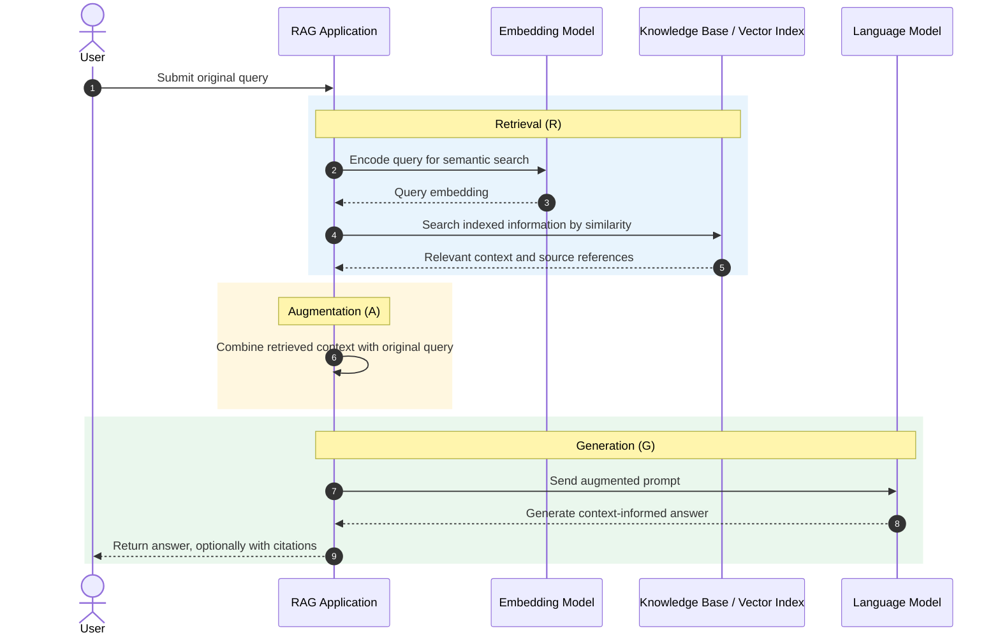
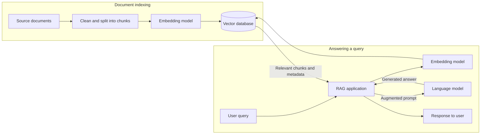
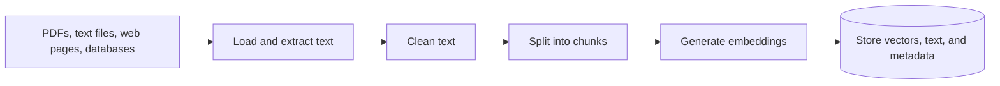

# RAG Fundamentals

## RAG Concept

**Retrieval-Augmented Generation (RAG)** combines three components: retrieval, augmentation, and generation.

### 1. Retrieval (R)

**Purpose:** Find relevant information from external knowledge sources.

**How it works:**

1. Searches databases, documents, or knowledge bases.
2. Uses semantic search via vector embeddings to match meaning, not just keywords.
3. Compares the user's query with indexed information to find the most relevant matches.

**Key technologies:**

- **Vector databases and indexes:** FAISS, ChromaDB, Pinecone, PgVector.
- **Embedding models:** `text-embedding-3-large`, sentence-transformers.
- **Search:** Similarity search algorithms.

### 2. Augmentation (A)

**Purpose:** Combine user input with retrieved information.

**How it works:**

1. Takes the original user query.
2. Adds the relevant retrieved context.
3. Creates an enhanced prompt: **Retrieved Context + Original Query**.

This enriched prompt provides the LLM with specific, relevant information.

#### Example: Microwave Troubleshooting

| Input | Content |
| --- | --- |
| Original query | How do I troubleshoot microwave heating issues? |
| Retrieved context | Microwave manual excerpt about magnetron problems, safety procedures, and related troubleshooting steps. |

**Augmented prompt:**

```text
Context:
[Microwave manual excerpt about magnetron problems, safety procedures, ...]

User query:
How do I troubleshoot microwave heating issues?
```

### 3. Generation (G)

**Purpose:** Create the final response using both the query and retrieved context.

**How it works:**

1. The LLM processes the augmented prompt.
2. Generates a response using the retrieved information alongside its training knowledge.
3. Can include citations and specific references to source materials.

RAG can improve accuracy, contextual relevance, and verifiability, but does not guarantee a correct answer.

### RAG Sequence

The sequence below starts with an already indexed knowledge source.



### Real-World Analogy: The Laundry Example

Imagine you ask someone to "wash all the red clothes."

| RAG stage | Laundry analogy |
| --- | --- |
| **Retrieval** | Searches your laundry basket to find the red items. |
| **Augmentation** | Combines your original request ("wash red clothes") with the actual red items found. |
| **Generation** | Responds with specific details about what was found and washed. |

The analogy illustrates selecting relevant items and using them in a response; RAG itself generates an answer rather than performing a physical task.

## Technical Implementation

A typical RAG system has an indexing path that prepares the knowledge base and a query path that retrieves context to answer a user's question.



### Core Components

#### Vector Database

Stores document embeddings and associated metadata so the system can search for similar content. Document chunks are prepared and indexed before query-time retrieval, as described in [Context Preparation](#context-preparation).

| Option | Description |
| --- | --- |
| **FAISS** | Fast, local, open-source similarity search. |
| **ChromaDB** | Developer-friendly option, often used for prototypes. |
| **Pinecone** | Managed cloud service designed to scale. |
| **PgVector** | PostgreSQL extension for storing and searching vectors. |

#### Embedding Models

Convert text into numerical vectors that represent semantic meaning. Use the same embedding model to encode indexed chunks and incoming queries.

| Provider / library | Examples |
| --- | --- |
| **OpenAI** | `text-embedding-3-large`, `text-embedding-3-small` |
| **Sentence Transformers** | `all-MiniLM-L6-v2` (lightweight) |

## Context Preparation

Before a RAG system can retrieve useful information, source documents need to be prepared and indexed.



### 1. Document Ingestion

- Load documents from sources such as PDFs, text files, web pages, or databases.
- Extract and clean their text content.

### 2. Text Chunking

Break large documents into manageable chunks. Chunk size and overlap affect what information is available together during retrieval.

**Common strategies:**

| Strategy | How it splits text |
| --- | --- |
| **Recursive character splitter** | Splits by larger boundaries such as paragraphs first, then sentences or characters as needed. |
| **Semantic splitter** | Splits based on meaning and context. |
| **Fixed-size chunking** | Splits by a set number of characters or tokens. |

**Example chunking configuration:**

```python
RecursiveCharacterTextSplitter(
    chunk_size=300,        # Characters per chunk
    chunk_overlap=50,      # Overlap between chunks
    separators=["\n\n", "\n", "."]  # Split hierarchy
)
```

### 3. Embedding Generation

Convert text chunks into vector representations, then store the embeddings with the chunk text and relevant metadata in a vector database. Index the stored vectors so they can be searched efficiently. Embedding generation is covered in more detail in the next section.

## Benefits of RAG

RAG offers several advantages over using a language model without a connected knowledge source. These are potential benefits, not guarantees; results depend on retrieval quality, source data, and system design.

1. **Provides relevant context**
    - Retrieves information related to the user's query.
    - Filters source material so the prompt does not need to include entire documents.
2. **Can reduce unsupported answers**
    - Grounds responses in retrieved documents.
    - Can provide source references that help users verify claims.
3. **Supports up-to-date knowledge**
    - Can retrieve information published after the model's training cutoff.
    - The knowledge base can be updated without retraining the model.
4. **Enables domain specialization**
    - Connects the model to an organization's proprietary documents and data.
    - Can support domain-specific answers without fine-tuning the model.
5. **Uses the context window more selectively**
    - Supplies relevant passages instead of entire documents.
    - Leaves more of the model's context window available for the query and response.
6. **May reduce costs**
    - Avoids retraining when source information changes.
    - Can be more efficient than fine-tuning for some use cases.
    - Actual costs depend on query volume, retrieval operations, model use, and knowledge-base size.

## Key Takeaways

1. **RAG has a simple core pattern:** Retrieve relevant information, combine it with the user's query, and generate a response.
2. **RAG is orchestration, not magic:** It brings together established APIs and machine-learning techniques.
3. **Quality depends on the data:** Preparing, cleaning, chunking, and organizing the knowledge base is essential to useful retrieval.

