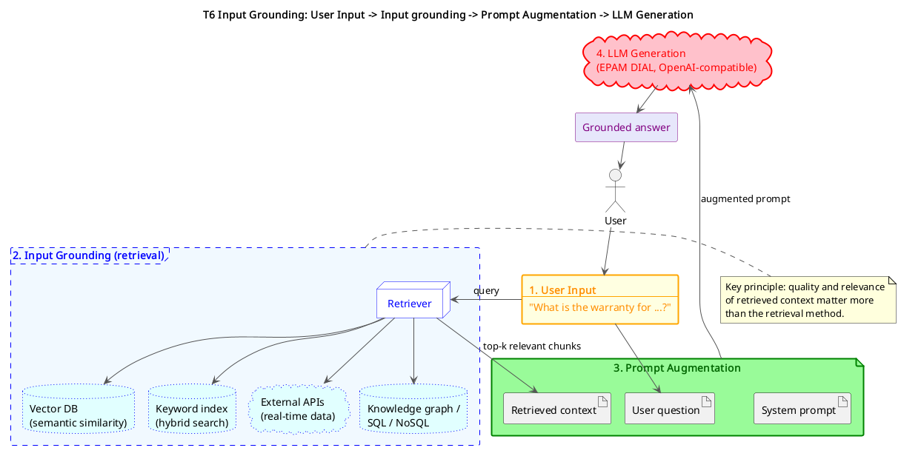
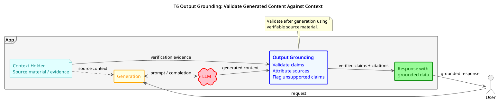

# Grounding

## About Grounding

> Grounding is the process of connecting AI-generated content to verifiable, external sources of information. It operates through two complementary mechanisms:

| Input Grounding | Output Grounding |
| --- | --- |
| Enriches queries and prompts with relevant contextual information during pre-processing, before AI generation occurs. | Validates and attributes AI-generated responses to verifiable sources during post-processing, after generation is complete. |

The primary benefits of implementing grounding include:

- **Hallucination Reduction:** Anchors responses to factual, verifiable sources rather than relying solely on training data
- **Enhanced Accuracy:** Provides access to current, domain-specific information beyond the model's knowledge cutoff
- **Cost Optimization:** Enables more efficient context usage by retrieving only relevant information rather than processing entire knowledge bases

## Input Grounding

```text
Flow: User Input → Input grounding → Prompt Augmentation → LLM Generation
```



Source: [diagrams/t6-input-grounding.puml](diagrams/t6-input-grounding.puml)

Core Implementation Approaches:
* **Vector-Based Retrieval:** Uses embedding models and vector databases (e.g., Pinecone, Weaviate) for semantic similarity search
* **Hybrid Search:** Combines vector search with traditional keyword-based methods (ElasticSearch, SQL/NoSQL databases)
* **API Integration:** Fetches real-time data from external services and APIs
* **Knowledge Graph Retrieval:** Leverages structured relationships in graph databases
* **Database Queries:** Direct integration with enterprise SQL/NoSQL systems
* **Multi-Modal Retrieval:** Incorporates text, images, audio, and video sources

Key Principle: The specific retrieval method matters less than the quality and relevance of the retrieved context. Success depends on selecting the appropriate data sources and retrieval strategies that best serve your use case requirements.


## Output Grounding

> Output Grounding (Post-Processing Validation) validates and attributes AI-generated responses to verifiable sources during post-processing, after the generation phase is complete. This approach ensures that model outputs can be traced back to reliable sources and verified for accuracy.

Key Benefits:
- **Verification:** Enables validation of AI-generated information
- **Trust Building:** Increases confidence in AI outputs through traceable sources
- **Quality Control:** Identifies and flags potentially inaccurate or unsupported claims
- **Hallucination Detection:** Catches AI-generated content that cannot be verified against source material



Source: [diagrams/t6-output-grounding.puml](diagrams/t6-output-grounding.puml)

**Output Grounding Techniques:**
- **Source Attribution:** Link generated claims back to specific source documents or data points
- **Fact Verification:** Cross-reference AI outputs against authoritative sources
- **Citation Generation:** Automatically generate references for supported claims
- **Confidence Scoring:** Assess reliability of generated content based on source strength
- **Claim Validation:** Verify factual accuracy through external verification systems
- **Semantic Verification:** Use additional AI models to validate logical consistency

Advanced Output Grounding:

For complex applications, output grounding can include:
- **Multi-source verification:** Cross-checking claims against multiple independent sources
- **Temporal validation:** Ensuring information currency and relevance
- **Bias detection:** Identifying potential biases in source materials or AI outputs
- **Confidence thresholds:** Setting minimum reliability standards for output acceptance
- **Human-in-the-loop validation:** Incorporating human oversight for critical applications

**Implementation Note:** Output Grounding works synergistically with Input Grounding. The context retrieved during input processing serves as the source material for post-generation validation and attribution. Think of it as: input grounding brings the right facts in, output grounding makes sure they came out correctly.

## Grounding Beyond RAG

> Grounding is often equated with RAG, but RAG is just one implementation pattern. Grounding is any mechanism that connects model output to verifiable, external context — and that context can come from many sources, retrieved through many methods, at different points in the request lifecycle.

A common misconception is that "grounding" means "vector database lookup." In practice, any of the following count as grounding when they bring authoritative context into the generation or validation loop:
* **Web Search:** Real-time queries against search engines or search APIs (e.g., Brave, Tavily, Google) for fresh, public information beyond the model's training cutoff
* **Live API Calls:** Pulling current data from internal microservices or SaaS APIs — weather, pricing, inventory, account state, anything that changes
* **Database Lookups:** Direct SQL or NoSQL queries when the answer lives in a structured store
* **Knowledge Graphs:** Traversing relationships in graph databases to surface connected facts
* **File and Document Access:** Reading from files, spreadsheets, or repositories provided in the conversation context

Choosing the Right Mechanism:
* **Static, internal knowledge (policies, manuals, past tickets) → vector search / RAG**
* **Fresh, public information (news, prices, current events) → web search**
* **Operational data (user records, orders, live state) → API or database lookup**

> **Key Principle**: Choose the grounding mechanism that matches the nature of the truth you need. RAG is a tool, not a definition. Production systems often combine several — for example, RAG for internal docs, web search for current events, and an API call for live account data, all feeding a single grounded response.

## Summary

Output grounding transforms AI from a confident-sounding black box into a transparent, accountable system. By combining traceability techniques like source attribution and citation generation with validation mechanisms like fact verification and semantic consistency checks, you ensure that what the model outputs can always be traced, tested, and trusted.

For most applications, starting with source attribution and fact verification will cover the majority of reliability concerns. As your system scales or moves into higher-stakes domains such as healthcare, legal, or finance, layering in multi-source verification, confidence scoring, and human-in-the-loop validation becomes not just beneficial, but essential.

The key mindset shift is this: output grounding is not about doubting the model. It is about building systems where trust is earned through evidence, not assumed through fluency.
