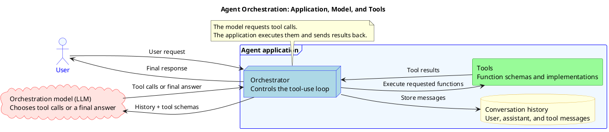
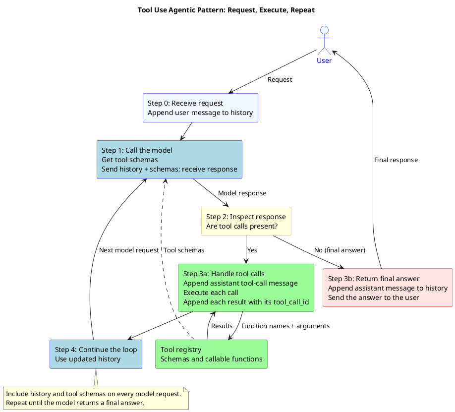

# Agents

## What is an AI Agent?

An AI Agent is an AI system designed to autonomously achieve goals through:
* **Planning** - Breaking down complex tasks into steps
* **Reasoning** - Making logical decisions based on available information
* **Taking Actions** - Executing specific operations using tools
* **Environment Interaction** - Responding to changing conditions
* **Learning from Experience** - Improving performance over time

Key Characteristics
* **Autonomy**: Can operate independently without constant human intervention
* **Tool Usage**: Can call external functions and APIs
* **Context Awareness**: Maintains conversation history and state
* **Goal-Oriented**: Works toward specific objectives

## How an AI Agents Works

AI Agents work through a cycle of:
1. Receive user request
2. Analyze available tools
3. Plan tool usage
4. Execute tool calls
5. Process results
6. Provide final response

> What are these tools, and where does an Agent take them?
> 
Before we answer this question, we need to name important keywords here:

| Agent | Tools | Orchestration model |
|------|-------|--------------------|
| In general, it's our application that has some tools and control over them, and can call an orchestration model (LLM). | Some functions that apply some input and provide some output. | The heart of the Agent flow. 
The orchestration model's main task is to handle user requests, and it can 'orchestrate' tools to achieve that.
It doesn't own any tools itself, but as a part of the Agent system, it knows that it can call/use some tools within the Agent to handle user requests. 



### Tool Use Agentic Pattern

This pattern we will implement in a practical task and it is commonly used nowadays.



## Tool Description

```json
{
  "messages": [...],
  "tools": [
    {
      "function": {
        "name": "function_name",
        "description": "What this tool does",
        "parameters": {
          "type": "object",
          "properties": {
            "param_name": {
              "type": "string|integer|boolean",
              "description": "Parameter description"
            }
          },
          "required": ["param_name"]
        }
      }
    }
  ]
}
```

| name | description | parameters |
|------|-------------|------------|
| Self-descriptive name of the tool | Description that will help the Orchestration model to understand when this tool should be used | JSON Schema of the parameters that the tool is expecting as input |

## Request Configuration and Response Flow

1st request:

```text
"Content-Type": "application/json"
Api-Key: {YOUR_API_KEY}
```

```json
{
  "messages": [
    {
      "role": "user",
      "content": "What is the weather in Kyiv now?"
    }
  ],
  "tools": [
    {
      "function": {
        "name": "web_search_tool",
        "description": "Performs search in the WEB.",
        "parameters": {
          "type": "object",
          "properties": {
            "request": {
              "type": "string",
              "description": "The search query or question to search for on the web"
             }
          },
          "required": ["request"]
        }
      }
    }
  ]
}
```

> Response from the Orchestration model on the 1st request:

```json
{
  "finish_reason": "tool_calls",
  "index": 0,
  "logprobs": null,
  "message": {
    "content": null,
    "refusal": null,
    "role": "assistant",
    "annotations": [],
    "tool_calls": [
      {
        "id": "call_JPC4Weswva2QABkEexX2fD5u",
        "function": {
          "name": "web_search_tool",
          "arguments": "{\"request\":\"What is the weather in Kyiv now?\"}"
      },
        "type": "function"
      }
    ]
  }
}
```

| Field | Meaning | Notes |
|-------|---------|-------|
| `finish_reason` | Indicates why the model stopped generating. | Possible values: `stop`, `length`, `content_filter`, and `tool_calls`. |
| `content` | The assistant's text response. | Some models return `null` when they request a tool call. |
| `tool_calls` | The tool calls requested by the orchestration model. | The array can contain one or more calls to help handle the user's request. |
| Tool call ID | Identifies a specific tool call. | Include this ID in the corresponding tool response so the model can match the result to the request. |
| Function name | Names the tool the model wants to call. | It must match a tool provided in the request. |
| Function arguments | JSON arguments for the requested tool. | The arguments follow the JSON Schema provided with the tool definition. |

> When we got the response with tool calls from the Orchestration model, we are handling these tool calls on the level of our application, and then we provide tool messages with the results of tool executions.

Request with tool call results:

```json
{
  "messages": [
    {
      "role": "user",
      "content": "What is the weather in Kyiv now?"
    },
    {
      "role": "assistant",
      "content": null,
      "tool_calls": [
        {
          "id": "call_JPC4Weswva2QABkEexX2fD5u",,
          "function": {
            "name": "web_search_tool",
            "arguments": "{\"request\":\"What is the weather in Kyiv now?\"}"
           },
          "type": "function"
        }
      ]
    },
    {
      "role": "tool",
      "content": "As of 3:31 PM in Kyiv, the weather is partly cloudy with a temperature of 18C/65F...",
      "tool_call_id": "call_JPC4Weswva2QABkEexX2fD5u",
      "name": "web_search_tool"
    }
  ],
  "tools": [
    {
      "function": {
        "name": "web_search_tool",
        "description": "Performs seaech in the WEB.",
        "parameters": {
          "type": "object",
          "properties": {
            "request": {
              "type": "string",
              "description": "The search query or question to search for on the web"
             }
          },
          "required": ["request"]
        }
      }
    }
  ]
}
```

1. Tool Call ID Matching: Always include the tool_call_id in tool response messages that matches the assistant's tool call id. Missing tool responses will trigger model errors indicating expected but missing tool call responses.
2. REST API Stateless Nature: The model doesn't persist conversation state between requests. You can modify tool_call_id value, but ensure consistency between assistant tool calls and corresponding tool response messages within the same request (change assistnat tool call id as well).
3. Tools Definition Required: Include the complete tools list with every request since the model treats each request independently without memory of previous interactions.

Final response from the Orchestration model:

```json
{
  "finish_reason": "stop",
  "index": 0,
  "logprobs": null,
  "message": {
    "content": "Currently, in Kyiv, the weather is partly cloudy with a temperature of 18C/65F...",
    "role": "assistant",
    "annotations": []
  }
}
```

We can identify this message as final from the Model since we don't have any tool calls.

## Summary

### What to read?

* [Tool Use Agent Pattern](https://microsoft.github.io/ai-agents-for-beginners/04-tool-use/)
* [Short article about the most common Agentic patterns](https://www.philschmid.de/agentic-pattern)
* [Agentic Design Patterns: A Hands-On Guide to Building Intelligent Systems](https://www.amazon.com/Agentic-Design-Patterns-Hands-Intelligent/dp/3032014018)


### Key Takeaways
* AI Agents extend LLMs with tool-using capabilities
* Implementation uses standard REST APIs
* Tool design is crucial for agent effectiveness
* Proper error handling and conversation management are essential

