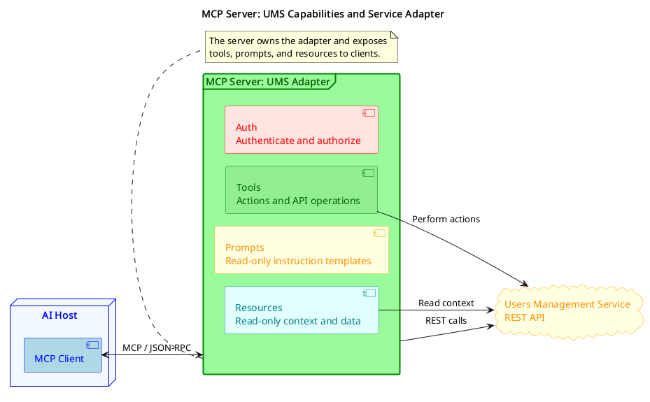
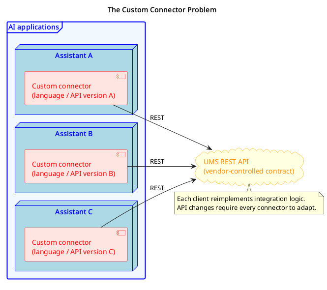
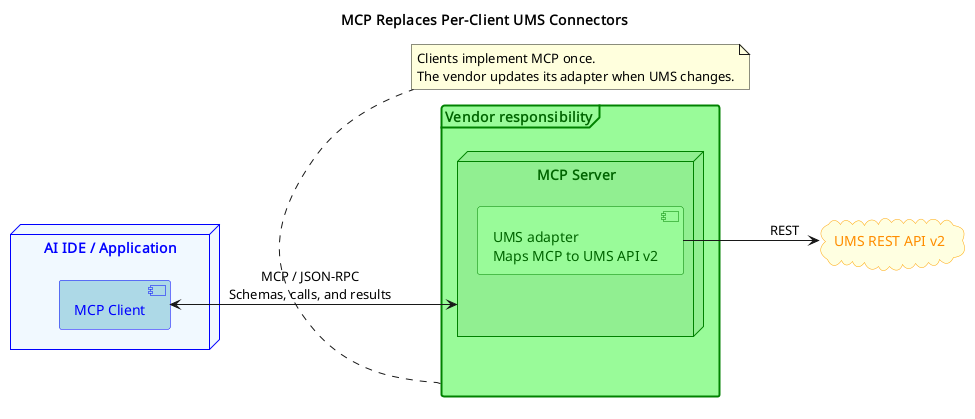

# MCP Fundamentals

## Introduction

As large language models became more capable, a new challenge emerged: how do you connect them to the real world in a reliable, scalable way? Each team building an AI-powered application had to reinvent the wheel, writing custom integrations for databases, APIs, file systems, and external services. The result was fragmented, hard to maintain, and not reusable across different models or platforms.

MCP (Model Context Protocol) was created to solve exactly this problem. It defines a unified, open standard for how LLMs communicate with external tools, data sources, and resources, so integrations built once can work anywhere MCP is supported.

Why MCP matters:

* **Standardization**: one protocol to connect any LLM to any tool, instead of dozens of one-off integrations
* **Reusability**: MCP Servers built by the community can be plugged into your application without modification
* **Separation of concerns**: tool logic lives in the MCP Server, keeping your AI application clean and focused
* **Security and control**: the protocol defines clear boundaries between the model, the client, and the tools it can access
* **Ecosystem growth**: a rapidly expanding library of ready-made MCP Servers covers databases, search engines, code interpreters, cloud services, and more

Today, MCP has become the de facto standard protocol for supplying LLMs with tools and resources. It is supported by major AI platforms, frameworks, and model providers, making it an essential concept for any developer building production-grade AI-powered applications.

## What is MCP?

> MCP (Model Context Protocol) is an open-source protocol that enables AI-powered applications to connect to external data sources and tools. It acts as a standardized interface between AI applications and various services. [Read more](https://modelcontextprotocol.io/docs/2026-07-28/getting-started/intro)

| HOST | MCP Clients | Protocol | MCP Servers |
|------|-------------|----------|-------------|
| Programs like Claude Desktop, IDEs, or AI tools that want to access data through MCP | Protocol clients on the HOST side that maintain 1:1 connections with servers | An open protocol that standardizes how applications provide context to LLMs | Lightweight programs that each expose specific capabilities through the standardized Model Context Protocol |

### Protocol

Model Context Protocol is built on top of the JSON-RPC protocol and standardizes the communication between MCP Clients and MCP Servers.

## MCP Server

We mentioned above that the MCP Server is a program that exposes 'some capabilities' standardized with Model Context Protocol. The value of MCP is that you can create an MCP Server that will work as an adapter to YOUR application and allow LLMs to communicate with YOUR application via this adapter by MCP.

Source: [diagrams/t9-mcp-server.puml](diagrams/t9-mcp-server.puml)

| Tools | Prompts | Resources | Auth |
|-------|---------|-----------|------|
| Functions that your AI-powered app can call. Tools can write to databases, call external APIs, modify files, or trigger other logic. | Pre-built instruction templates that tell the model to work with specific tools and resources. Read-only! | Passive data sources that provide read-only access to information for context, such as file contents, database schemas, or API documentation. | Authentication and authorization mechanisms that control access to server resources and tools, including API keys, OAuth flows, and permission scopes. |

## MCP Client

MCP clients are instantiated by host applications to communicate with particular MCP servers. The host application, like Claude.ai or an IDE, manages the overall user experience and coordinates multiple clients. Each client handles one direct communication with one server.

Understanding the distinction is important: the host is the application users interact with, while clients are the protocol-level components that enable server connections.

> The HOST only needs to implement this client once, and with this implementation, it will be able to connect to almost all MCP Servers via the Model Context Protocol.

## MCP Connection types

**SSE (Server-Sent Events) Deprecated:** An older HTTP-based transport that used a persistent one-way stream from server to client, with a separate HTTP endpoint for client-to-server messages. Replaced by Streamable HTTP and no longer recommended for new implementations. [Official documentation](https://mcp-framework.com/docs/Transports/sse/)

**STDIO (Standard Input/Output):** The simplest transport type, where the MCP Client launches the MCP Server as a subprocess and communicates via standard input/output streams. Best suited for local integrations, CLI tools, and desktop environments where both client and server run on the same machine. [Official documentation](https://modelcontextprotocol.io/docs/concepts/transports#standard-input%2Foutput-stdio)

**Streamable HTTP:** The current standard transport for production deployments. Uses regular HTTP requests with optional streaming via SSE when needed, making it compatible with existing infrastructure, load balancers, and cloud environments. The go-to choice for remote MCP Servers, web-based integrations, and any scenario where client and server run on different machines. [Official documentation](https://modelcontextprotocol.io/docs/concepts/transports#streamable-http)

## Reason

> Probably you have a question now: **Why do we need it if we can configure and add any tools for an Agent as we have done before?**

The reason will be simpler to explain with a sample:

Source: [diagrams/t9-custom-connectors.puml](diagrams/t9-custom-connectors.puml)

Imagine that we have our UMS(Users Management Service) and a lot of clients are using the UMS API to work with users within the system. Let's say we have 1000  clients.

The problems here are:
1. **Custom code**: All of them MUST implement their own custom clients to connect to UMS. 
   **Solution**: UMS creates SDK with client
2. **Different language support**: Let's imagine that UMS provided an SDK for Java, Python, JS, and PHP. What should other clients do when they use Scala, .NET, C++, etc?
3. **Changes lock**: What if UMS decides to change its API? - In such case all the clients need to change their custom code as well.
   **Solution** : Adding API versioning. It won't resolve the problem because all the clients eventually have to change the code of their custom clients. 
4. With 1k of clients, we probably can withstand such pressure, but imagine if we are Notion and have millions of users who want to connect it to AI?

So, we can identify the problem that clients depend on a Vendor, and it creates problems on both sides:

* **for clients** that they need to implement custom code to connect to Vendor API
* **for vendors** that they are locked with changes, since it can break communication with clients

Source: [diagrams/t9-mcp-adapter.puml](diagrams/t9-mcp-adapter.puml)

* The Client creates an MCP Client, and with it will be able to work with almost all MCP Servers. In case the Vendor changes the API, the client will fetch new tool schemas and will be able to proceed its work.
* The Vendor is now unlocked to make changes. But it has an additional responsibility to keep the MCP Server up to date with the UMS API.

## Summary

MCP standardizes how AI applications connect to external services, eliminating the need for custom integrations.

**Key Benefits:**

* **For Developers**: One client implementation connects to any MCP server
* **For Service Providers**: One server reaches all MCP-compatible applications
* **For Users**: Seamless integration between AI tools and services

**The Impact:**

Instead of building separate integrations for each service, AI applications need just one MCP client. Service providers can focus on their core functionality while exposing it through the standardized MCP interface.

**MCP transforms fragmented custom integrations into a unified, scalable ecosystem**, enabling AI applications to seamlessly access the tools and data users need.
